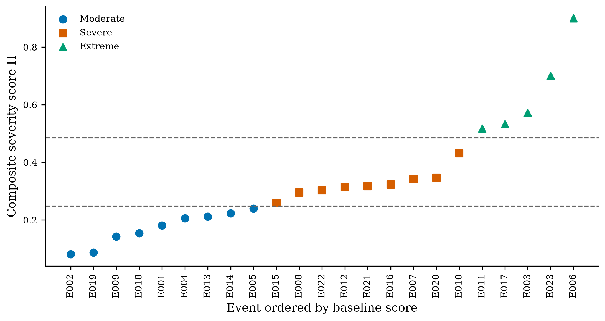
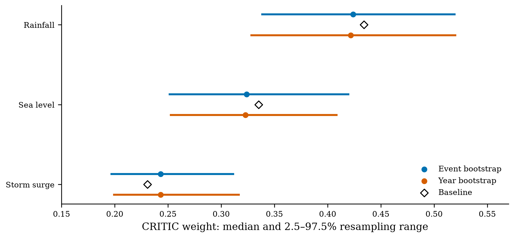
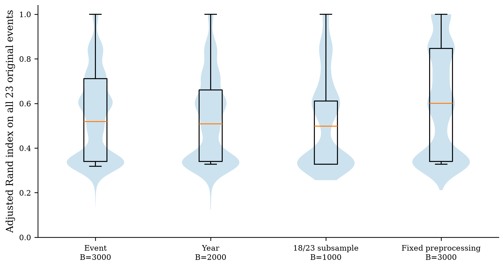
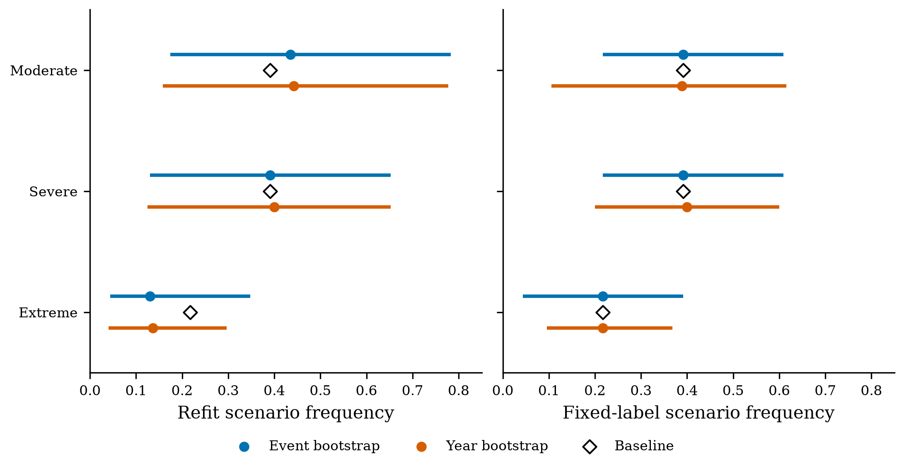
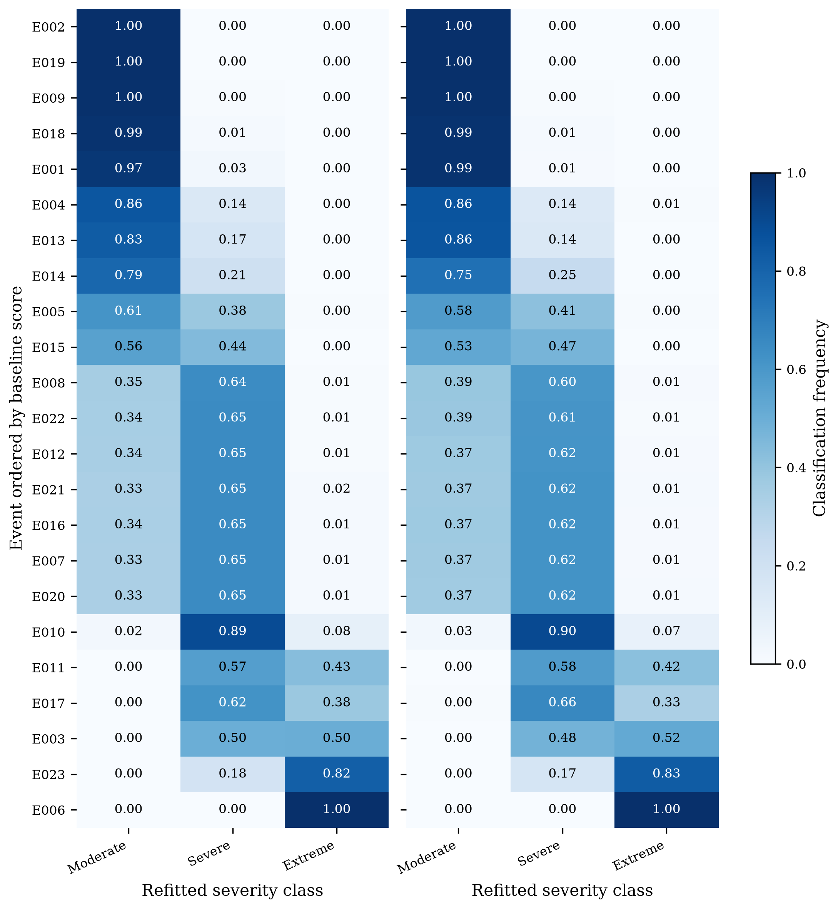
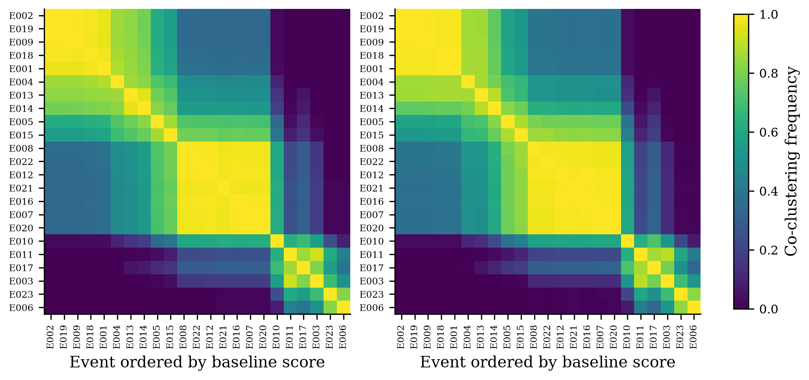
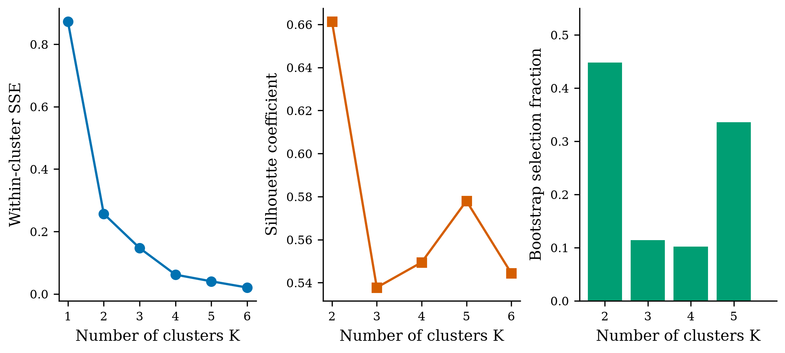
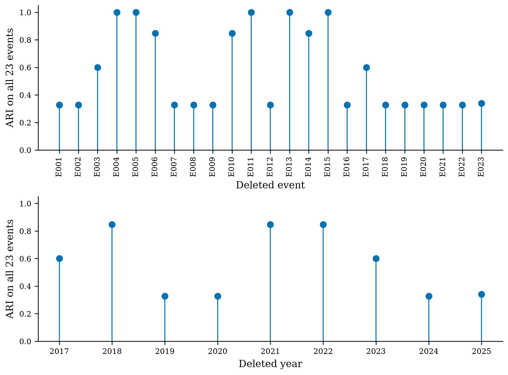
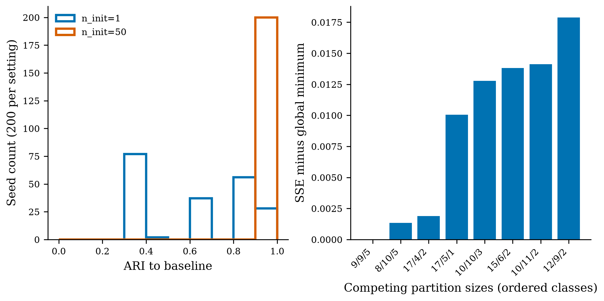
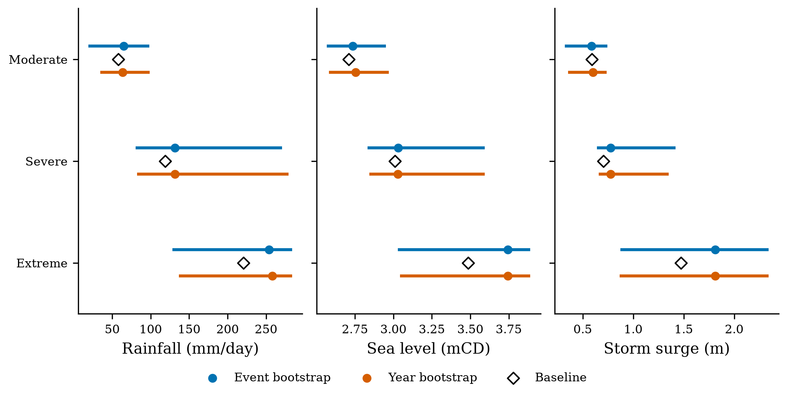

# 23條事件的CRITIC權重與K-means場景穩定性審核

日期：2026-11-03。審核對象：CRISP R-W-S fallback，2017—2025年23條已選事件。

更正紀錄 2026-11-04：原文及圖9說明將連續三段切分數誤寫為253，現更正為231，即C(22,2)。僅更正計數文字；凍結輸入、SSE、分類及重抽樣結果未改動。

## Material Passport

本報告使用`01_Data/Events/`中凍結的模型輸入、事件來源名錄、原設定及已存結果，統一使用當前生產管線與兩張參考表格，歷史副本已歸檔。計算與原輸出已重現並進行數值核查。這不等於逐條核實香港天文台原始觀測，也不證明樣本完整或代表Tai O全部洪水。無插補、無事件刪除、無數值缺失、無重複三指標向量。分析階段及復現驗證均已完成；沒有尚待批准的計算步驟。

## 1. 可支持的結論

1. **基線計算正確且可重現**：CRITIC權重為0.434081、0.335229、0.230689；23個H及分類與原管線、已存CSV一致。K=3類大小為9/9/5。
2. **權重存在可見抽樣不確定性**：降雨權重在事件bootstrap中居首的比例為89.2%。不能將基線排序視作確定結論，也不能將資料離散性權重解讀成災害因果貢獻或政策偏好。
3. **分群對樣本變動敏感**：事件bootstrap ARI中位數0.519，年份bootstrap為0.508。即使凍結歸一化與權重、只重擬合聚類，也沒有消除不穩定性。
4. **固定基線上隨機初始化穩定，不代表樣本穩定**：原設定n_init=50時，200個種子全部回到同一分類；單次初始化ARI最小為0.302。對重抽樣資料，仍有37/9032次50初始化未達全局最低SSE，已另計全局解ARI作對照，沒有隱藏這項算法誤差。
5. **三類應視為建模用的相對分級**：全樣本K=2輪廓系數0.661，高於K=3的0.538。目前證據不足以確認存在三種天然、可外推的災害類型。

## 2. 資料與適用範圍

降雨是事件日前後各2日（共5日）窗口的**最大日累積雨量**，不是最大小時雨強。海平面是Shek Pik最高水位（mCD），S保留該站官方表中的天文潮以上增水（m），不是Tai O淹水深度；E020的0.66 m是東北季風與Man-yi共同作用造成的maximum sea level rise，不是分離估計的純台風分量。三項最大值未必同時發生。降雨來源包含19條Ngong Ping、3條機場、1條Discovery Bay記錄，站點混用可能影響尺度與相關性。原始來源URL、站點及品質註記完整保留於`01_Data/Events/event_metadata.csv`。

年份分布：

| year | Moderate | Severe | Extreme |
| --- | --- | --- | --- |
| 2017 | 4 | 0 | 1 |
| 2018 | 0 | 0 | 1 |
| 2019 | 0 | 1 | 0 |
| 2020 | 1 | 1 | 0 |
| 2021 | 0 | 1 | 1 |
| 2022 | 2 | 1 | 0 |
| 2023 | 0 | 2 | 1 |
| 2024 | 2 | 1 | 0 |
| 2025 | 0 | 2 | 1 |

總量只有23事件、9年份塊；Extreme基線只有5事件。抽樣入選規則及未入選事件的母體名錄尚不完整。這是**選定事件中的條件分布**，不是所有日、所有年份、全部洪水或未來氣候下的無條件分布。年份並非密集時間序列，不能藉此估計可靠的自相關或長期氣候趨勢。

## 3. 基線公式、實作及論文表格核對

各指標均採「數值越大，危害分數越高」方向，逐欄Min-Max：`z_ij=(x_ij-min_j)/(max_j-min_j)`；Pearson相關矩陣為r；`C_j=sd(z_j)×Σ_k(1-r_jk)`，`w_j=C_j/ΣC_j`；`H_i=Σ_j w_j z_ij`。這個變異與衝突的加權思想來自[CRITIC原論文](https://doi.org/10.1016/0305-0548(94)00059-H)，本次對具體公式及邊界處理以歸檔程式作為可執行定義。

K-means只作用在一維H，並非三項原指標的多變量聚類。固定K=3、seed=42、n_init=50、max_iter=300、Lloyd；按中心遞增標為Moderate/Severe/Extreme。兩個閾值為相鄰中心中點，等於閾值時歸入較高類。初始化設定依[scikit-learn KMeans文件](https://scikit-learn.org/stable/modules/generated/sklearn.cluster.KMeans.html)明確指定，避免版本預設值改變。

| indicator | minimum | maximum | normalized_std | conflict | information | weight |
| --- | --- | --- | --- | --- | --- | --- |
| rainfall | 13.5000 | 351.9000 | 0.2480 | 1.3300 | 0.3298 | 0.4341 |
| sea_level | 2.3800 | 3.9100 | 0.2603 | 0.9783 | 0.2547 | 0.3352 |
| storm_surge | 0.2200 | 2.3400 | 0.2204 | 0.7951 | 0.1753 | 0.2307 |

原CSV權重最大絕對差5.55e-17；H最大差1.11e-16。與生產管線H最大差1.11e-16。枚舉排序23條H的全部231種二切點（C(22,2)），基線K=3 SSE=0.146972733252，確認達到全局最低值。

ddof=0改為1時，三個標準差同乘√(23/22)=1.022475，CRITIC歸一權重因共同因子抵消而不變（數值差5.55e-17）。論文中標準差和信息量仍應與設定統一，不能因最終權重相同便混用中間量。

**展示用XLSX核對**：兩張原表的權重、9/9/5計數、頻率及四捨五入的代表值與基線相符。但CRITIC表把降雨描述為“Maximum rainfall intensity”，與最大日總雨量的實際輸入不符；場景表“Representative Rainfall (mm)”也未交代5日窗口及日累積基礎。建議改為“Event-window maximum daily rainfall (mm/day)”，並把Probability標為“Conditional frequency among selected events”。原表已保留，未直接覆寫。單元格抽取存於`publication_table_cells.json`。

## 4. 重抽樣與穩定性設計

方案在本次運算前保存於`分析方案.md`，屬探索性審核而非外部預註冊。主種子20261103；NumPy SeedSequence為事件、年份、子抽樣建立獨立亂數流。全部抽樣索引（從0起算）保存在`resample_indices.json`，含事件ID順序與年份抽中名單。

- 事件bootstrap：有放回抽23行，B=3000，完整重估Min-Max、CRITIC、H、K=3。
- 年份分塊bootstrap：從9個已觀察年份中有放回抽9個年份塊，B=2000，每塊所有事件完整保留，樣本長度可變。這是年份cluster bootstrap，不是按連續年份窗口的moving-block bootstrap。
- 凍結預處理對照：使用與事件bootstrap相同的3000組索引，固定全樣本Min-Max和CRITIC權重，只重擬合K=3。這是敏感性對照，不是無資料洩漏的驗證流程。
- 80%子抽樣：不放回抽18條，B=1000；逐事件刪除23次；逐年份刪除9次。

重抽樣的重複行保留為抽樣權重，沒有被去重。每次依當次訓練Min-Max、權重和中心，將**共同23條原始事件投射**後比較。投射值超出訓練[0,1]時不裁切，因未見極值是抽樣敏感性的一部分。所有ARI、共分群及按排序等級對齊的Jaccard使用共同23行；場景訓練頻率則分母為當次重抽樣行數，另存原23行投射頻率。

ARI採機會校正，1表示兩分類完全一致；它不是洪水分類準確率，沒有真實標籤可用。[ARI官方定義](https://scikit-learn.org/stable/modules/generated/sklearn.metrics.adjusted_rand_score.html)。本次Jaccard是**按中心等級對齊的投射集合交並比**，不等同於Hennig原方法中逐群取最大相似群的bootstrap統計；[Hennig原論文](https://doi.org/10.1016/j.csda.2006.11.025)也指出穩定性本身不保證類型有意義。

區間統一採成功擬合的2.5%及97.5%經驗分位數。這是條件於現有資料與抽樣機制的**95%重抽樣範圍**，沒有在n=23、Min-Max極值和離散分類下證明名義覆蓋率。刪除檢驗只報最小至最大值。完整明細保留退化原因和成功分母，本次全部成功，0次退化或排除。

## 5. CRITIC權重結果

| 指標 | 基線權重 | 事件95%範圍 | 年份95%範圍 | 事件權重居首比例 |
| --- | --- | --- | --- | --- |
| rainfall | 0.4341 | 0.3376–0.5203 | 0.3274–0.5208 | 0.8920 |
| sea_level | 0.3352 | 0.2507–0.4204 | 0.2518–0.4094 | 0.1067 |
| storm_surge | 0.2307 | 0.1960–0.3121 | 0.1984–0.3174 | 0.0013 |

| 方法 | 權重差 | q025 | 中位數 | q975 | 差大於零比例 |
| --- | --- | --- | --- | --- | --- |
| 事件bootstrap | rainfall - sea_level | -0.0725 | 0.1005 | 0.2510 | 0.8930 |
| 事件bootstrap | sea_level - storm_surge | -0.0343 | 0.0802 | 0.1952 | 0.8963 |
| 年份分塊bootstrap | rainfall - sea_level | -0.0751 | 0.0984 | 0.2579 | 0.8955 |
| 年份分塊bootstrap | sea_level - storm_surge | -0.0389 | 0.0776 | 0.1800 | 0.9020 |

兩個權重邊際區間重疊不等於差異檢定，故另報配對權重差與差大於零的比例；這些比例不解讀成權重大小關係為真的貝氏後驗機率或p值。標準差與相關性都是從同一小樣本估得，重抽樣數增加不會增加獨立事件數。

## 6. 分群穩定性、近似競爭分割與算法誤差

| 方法 | 成功/嘗試 | ARI中位數 | ARI範圍 | 全局解ARI中位數 | H排序Spearman中位數 |
| --- | --- | --- | --- | --- | --- |
| 事件bootstrap | 3000/3000 | 0.5192 | 0.3183–1.0000 | 0.5192 | 0.9941 |
| 凍結歸一化與權重 | 3000/3000 | 0.6001 | 0.3273–1.0000 | 0.6001 | 1.0000 |
| 年份分塊bootstrap | 2000/2000 | 0.5085 | 0.3273–1.0000 | 0.5085 | 0.9941 |
| 18/23不放回子抽樣 | 1000/1000 | 0.4980 | 0.3273–1.0000 | 0.4945 | 0.9980 |
| 逐事件刪除 | 23/23 | 0.3273 | 0.3273–1.0000 | 0.3273 | 1.0000 |
| 逐年刪除 | 9/9 | 0.6001 | 0.3273–0.8471 | 0.6001 | 0.9990 |

完整資料全局解9/9/5的SSE為0.146973；另有17/4/2的自洽局部解，SSE為0.148860，僅多0.001888（1.28%），但對原分類ARI僅0.327。這種低目標差而高分類差的競爭切分，解釋為何很小的樣本變化也可造成大幅類別變動。`competing_partitions.csv`還列出其他連續切分；其中self_consistent=False的強制切分並非Lloyd固定點，不應稱為另一個自洽K-means解。

| 方法 | 擬合數 | 非全局最低SSE數 | Lloyd平均ARI | 全局解平均ARI | 最大SSE差 |
| --- | --- | --- | --- | --- | --- |
| 事件bootstrap | 3000 | 14 | 0.5415 | 0.5413 | 0.0158 |
| 凍結歸一化與權重 | 3000 | 15 | 0.5978 | 0.5979 | 0.0051 |
| 年份分塊bootstrap | 2000 | 6 | 0.5278 | 0.5276 | 0.0061 |
| 18/23不放回子抽樣 | 1000 | 2 | 0.5210 | 0.5206 | 0.0058 |
| 逐事件刪除 | 23 | 0 | 0.5656 | 0.5656 | 0.0000 |
| 逐年刪除 | 9 | 0 | 0.5626 | 0.5626 | 0.0000 |

全局解審核採獨立的排序切點枚舉／前綴和SSE公式；以1e-10判定Lloyd非最優。主分析保留原50次初始化結果，另報全部重抽樣的全局投射ARI，因此可以看出樣本不穩定並非主要由隨機初始化造成。H排序的Spearman相關通常高於離散分類一致性，意味分數排序與三類邊界的穩定性需要分開判斷。

## 7. 場景頻率、中心、閾值及代表量

| 場景 | 事件數 | 原頻率 | 事件完整流程95%範圍 | 年份完整流程95%範圍 | 固定分類Wilson95%參照 |
| --- | --- | --- | --- | --- | --- |
| Moderate | 9 | 0.3913 | 0.1739–0.7826 | 0.1579–0.7779 | 0.2216–0.5921 |
| Severe | 9 | 0.3913 | 0.1304–0.6522 | 0.1250–0.6522 | 0.2216–0.5921 |
| Extreme | 5 | 0.2174 | 0.0435–0.3478 | 0.0400–0.2963 | 0.0966–0.4190 |

Wilson欄只是假設事件獨立且分類事先固定時的逐類二項95%參照，忽略資料選擇、年內依賴與分類估計，並不是完整流程區間或三類同時區間。完整流程Extreme的事件bootstrap中位數為0.1304，低於基線0.2174；排序後最上層類在部分重抽樣中只代表少數最頂端事件，不能將其視為固定不變的同一種物理極端災害。

| 量 | 原值 | 事件95%範圍 | 年份95%範圍 |
| --- | --- | --- | --- |
| Moderate center | 0.1697 | 0.0781–0.2699 | 0.0725–0.2613 |
| Severe center | 0.3258 | 0.2778–0.6123 | 0.2774–0.6203 |
| Extreme center | 0.6445 | 0.5881–1.0000 | 0.5978–1.0000 |
| tau1 | 0.2478 | 0.1848–0.4320 | 0.1814–0.4340 |
| tau2 | 0.4852 | 0.4470–0.7962 | 0.4522–0.7832 |

每次重估Min-Max與權重後，H的座標系也改變。中心及閾值區間是整個程序的輸出變動範圍，不能直接當成固定物理刻度上的門檻信賴區間。以下原量綱代表值是每次**訓練類內算術均值**，含重複抽樣行：

| 場景 | 指標 | 原代表均值 | 事件95%範圍 | 年份95%範圍 |
| --- | --- | --- | --- | --- |
| Moderate | rainfall | 57.9667 | 19.1667–98.1391 | 34.6144–98.4867 |
| Moderate | sea_level | 2.7100 | 2.5667–2.9514 | 2.5800–2.9707 |
| Moderate | storm_surge | 0.5911 | 0.3240–0.7436 | 0.3567–0.7370 |
| Severe | rainfall | 118.8111 | 80.2684–270.9667 | 82.0809–279.0340 |
| Severe | sea_level | 3.0100 | 2.8318–3.5943 | 2.8447–3.5950 |
| Severe | storm_surge | 0.7044 | 0.6400–1.4200 | 0.6583–1.3500 |
| Extreme | rainfall | 220.6800 | 128.1159–283.8743 | 136.8333–283.8548 |
| Extreme | sea_level | 3.4860 | 3.0300–3.8900 | 3.0440–3.8900 |
| Extreme | storm_surge | 1.4740 | 0.8733–2.3400 | 0.8667–2.3400 |

代表量和綜合分數不是物理聯合水文模型。本次不把代表量重新注入後端MILP，也不宣稱這些區間等於決策效益的不確定性；主模型目前使用固定輸入概率，後續若傳播到決策層，需明確聯動機制，不能只替換結果表。

## 8. 逐事件與刪除影響明細

下表為全部23條記錄。agreement是3000次事件bootstrap投射回原分類的比例；p欄是投射到三類的比例。OOB是該事件完全未被抽入訓練時的子集，分母n_oob另列。OOB比較對象仍是使用過全樣本的基線分類，不能稱為外部準確率。

| event_id | event_name | H | baseline_scenario | agreement | p_Moderate | p_Severe | p_Extreme | n_oob | oob_agreement |
| --- | --- | --- | --- | --- | --- | --- | --- | --- | --- |
| E001 | Severe Tropical Storm Merbok | 0.1809 | Moderate | 0.9690 | 0.9690 | 0.0310 | 0.0000 | 1100 | 0.9682 |
| E002 | Tropical Storm Roke | 0.0811 | Moderate | 1.0000 | 1.0000 | 0.0000 | 0.0000 | 1089 | 1.0000 |
| E003 | Super Typhoon Hato | 0.5719 | Extreme | 0.5037 | 0.0000 | 0.4963 | 0.5037 | 1071 | 0.4921 |
| E004 | Severe Tropical Storm Pakhar | 0.2064 | Moderate | 0.8553 | 0.8553 | 0.1430 | 0.0017 | 1099 | 0.8835 |
| E005 | Severe Typhoon Khanun | 0.2392 | Moderate | 0.6137 | 0.6137 | 0.3817 | 0.0047 | 1094 | 0.6435 |
| E006 | Super Typhoon Mangkhut | 0.9002 | Extreme | 1.0000 | 0.0000 | 0.0000 | 1.0000 | 1073 | 1.0000 |
| E007 | Tropical Storm Wipha | 0.3425 | Severe | 0.6520 | 0.3343 | 0.6520 | 0.0137 | 1088 | 0.5763 |
| E008 | Typhoon Higos | 0.2956 | Severe | 0.6447 | 0.3483 | 0.6447 | 0.0070 | 1074 | 0.6425 |
| E009 | Tropical Storm Nangka | 0.1433 | Moderate | 0.9957 | 0.9957 | 0.0043 | 0.0000 | 1099 | 0.9973 |
| E010 | Tropical Storm Lionrock | 0.4315 | Severe | 0.8910 | 0.0243 | 0.8910 | 0.0847 | 1091 | 0.8928 |
| E011 | Typhoon Kompasu | 0.5176 | Extreme | 0.4303 | 0.0000 | 0.5697 | 0.4303 | 1042 | 0.4655 |
| E012 | Typhoon Chaba | 0.3147 | Severe | 0.6523 | 0.3407 | 0.6523 | 0.0070 | 1071 | 0.6340 |
| E013 | Typhoon Ma-on | 0.2115 | Moderate | 0.8290 | 0.8290 | 0.1703 | 0.0007 | 1083 | 0.7969 |
| E014 | Severe Tropical Storm Nalgae | 0.2237 | Moderate | 0.7880 | 0.7880 | 0.2107 | 0.0013 | 1059 | 0.7856 |
| E015 | Typhoon Talim | 0.2590 | Severe | 0.4420 | 0.5567 | 0.4420 | 0.0013 | 1079 | 0.4263 |
| E016 | Super Typhoon Saola | 0.3230 | Severe | 0.6490 | 0.3383 | 0.6490 | 0.0127 | 1103 | 0.6183 |
| E017 | Severe Typhoon Koinu | 0.5324 | Extreme | 0.3793 | 0.0010 | 0.6197 | 0.3793 | 1126 | 0.4742 |
| E018 | Super Typhoon Yagi | 0.1541 | Moderate | 0.9857 | 0.9857 | 0.0143 | 0.0000 | 1072 | 0.9785 |
| E019 | Typhoon Toraji | 0.0875 | Moderate | 1.0000 | 1.0000 | 0.0000 | 0.0000 | 1067 | 1.0000 |
| E020 | Super Typhoon Man-yi | 0.3462 | Severe | 0.6513 | 0.3340 | 0.6513 | 0.0147 | 1083 | 0.5900 |
| E021 | Typhoon Wipha | 0.3175 | Severe | 0.6517 | 0.3330 | 0.6517 | 0.0153 | 1074 | 0.6257 |
| E022 | Severe Tropical Storm Tapah | 0.3026 | Severe | 0.6503 | 0.3447 | 0.6503 | 0.0050 | 1067 | 0.6504 |
| E023 | Super Typhoon Ragasa | 0.7006 | Extreme | 0.8183 | 0.0000 | 0.1817 | 0.8183 | 1085 | 0.7005 |

最不穩定者包括E017 Koinu、E011 Kompasu與E015 Talim，並非只涉及原始閾值最近的一條事件。完整流程可能整體更換切分方式，因此需要共分群圖輔助理解。

| deleted_event | ARI | agreement | w_rainfall | w_sea_level | w_storm_surge | p_train_Extreme |
| --- | --- | --- | --- | --- | --- | --- |
| E001 | 0.3273 | 0.5217 | 0.4365 | 0.3356 | 0.2279 | 0.0909 |
| E002 | 0.3273 | 0.5217 | 0.4374 | 0.3295 | 0.2330 | 0.0909 |
| E003 | 0.6001 | 0.8261 | 0.4420 | 0.3182 | 0.2398 | 0.0909 |
| E004 | 1.0000 | 1.0000 | 0.4336 | 0.3382 | 0.2282 | 0.2273 |
| E005 | 1.0000 | 1.0000 | 0.4324 | 0.3428 | 0.2248 | 0.2273 |
| E006 | 0.8471 | 0.9565 | 0.4121 | 0.2987 | 0.2893 | 0.1818 |
| E007 | 0.3273 | 0.5217 | 0.4398 | 0.3312 | 0.2290 | 0.0909 |
| E008 | 0.3273 | 0.5217 | 0.4343 | 0.3350 | 0.2307 | 0.0909 |
| E009 | 0.3273 | 0.5217 | 0.4302 | 0.3405 | 0.2293 | 0.0909 |
| E010 | 0.8471 | 0.9565 | 0.4201 | 0.3517 | 0.2283 | 0.2273 |
| E011 | 1.0000 | 1.0000 | 0.4372 | 0.3348 | 0.2280 | 0.1818 |
| E012 | 0.3273 | 0.5217 | 0.4342 | 0.3355 | 0.2303 | 0.0909 |
| E013 | 1.0000 | 1.0000 | 0.4299 | 0.3376 | 0.2325 | 0.2273 |
| E014 | 0.8471 | 0.9565 | 0.4301 | 0.3368 | 0.2330 | 0.2273 |
| E015 | 1.0000 | 1.0000 | 0.4343 | 0.3345 | 0.2313 | 0.2273 |
| E016 | 0.3273 | 0.5217 | 0.4352 | 0.3344 | 0.2304 | 0.0909 |
| E017 | 0.6001 | 0.8261 | 0.4181 | 0.3489 | 0.2330 | 0.0909 |
| E018 | 0.3273 | 0.5217 | 0.4398 | 0.3294 | 0.2309 | 0.0909 |
| E019 | 0.3273 | 0.5217 | 0.4319 | 0.3366 | 0.2315 | 0.0909 |
| E020 | 0.3273 | 0.5217 | 0.4450 | 0.3228 | 0.2322 | 0.0909 |
| E021 | 0.3273 | 0.5217 | 0.4485 | 0.3244 | 0.2271 | 0.0909 |
| E022 | 0.3273 | 0.5217 | 0.4346 | 0.3359 | 0.2295 | 0.0909 |
| E023 | 0.3401 | 0.4783 | 0.4352 | 0.3346 | 0.2302 | 0.0455 |

| deleted_year | n_train | ARI | agreement | w_rainfall | w_sea_level | w_storm_surge |
| --- | --- | --- | --- | --- | --- | --- |
| 2017 | 18 | 0.6001 | 0.8261 | 0.4431 | 0.3139 | 0.2430 |
| 2018 | 22 | 0.8471 | 0.9565 | 0.4121 | 0.2987 | 0.2893 |
| 2019 | 22 | 0.3273 | 0.5217 | 0.4398 | 0.3312 | 0.2290 |
| 2020 | 21 | 0.3273 | 0.5217 | 0.4302 | 0.3404 | 0.2294 |
| 2021 | 21 | 0.8471 | 0.9565 | 0.4228 | 0.3512 | 0.2260 |
| 2022 | 20 | 0.8471 | 0.9565 | 0.4257 | 0.3396 | 0.2347 |
| 2023 | 20 | 0.6001 | 0.8261 | 0.4200 | 0.3476 | 0.2324 |
| 2024 | 20 | 0.3273 | 0.5217 | 0.4481 | 0.3188 | 0.2331 |
| 2025 | 20 | 0.3401 | 0.4783 | 0.4498 | 0.3246 | 0.2256 |

逐事件刪除後，降雨權重仍全部居首；但分群ARI最低達0.327。兩種穩定性並不能互相替代。以上範圍是完整刪除集合的影響診斷，不是抽樣分布的信賴區間。

## 9. K的敏感性

| k | sse | min_cluster_count | silhouette | calinski_harabasz | davies_bouldin |
| --- | --- | --- | --- | --- | --- |
| 1 | 0.8726 | 23 | — | — | — |
| 2 | 0.2566 | 5 | 0.6613 | 50.4040 | 0.5110 |
| 3 | 0.1470 | 5 | 0.5378 | 49.3736 | 0.5012 |
| 4 | 0.0617 | 2 | 0.5495 | 83.1919 | 0.4946 |
| 5 | 0.0405 | 2 | 0.5780 | 92.5506 | 0.4694 |
| 6 | 0.0206 | 1 | 0.5445 | 140.9396 | 0.3298 |

| K | 勝出次數 | 比例 |
| --- | --- | --- |
| 2 | 224 | 0.4480 |
| 3 | 57 | 0.1140 |
| 4 | 51 | 0.1020 |
| 5 | 168 | 0.3360 |

輪廓系數衡量群內緊密度與群間分離度，詳見[官方定義](https://scikit-learn.org/stable/modules/generated/sklearn.metrics.silhouette_score.html)。K=2在基線輪廓系數較高；其他指標也不一致支持K=3，較大K還產生2條甚至1條記錄的小群。前500次事件bootstrap只在K=2—5中比較輪廓系數，沒有把K=6納入這項抽樣比較；含重複行的內部指標偏好不能直接當作真實K的機率。若需要三個決策場景，可保留K=3作規劃約定，但必須同時揭露分類穩定性不足。

## 10. 樣本量限制與可行性邊界

- **不可從23條提高到3000條證據**：B只控制蒙地卡羅精度。事件B=3000的任一比例估計最大蒙地卡羅標準誤約0.0091；年份B=2000約0.0112。這不是母體估計誤差，分位端點仍有模擬波動。
- **事件獨立性未證明**：同年事件及重疊天氣背景可能相關。年份分塊保留年內依賴，但僅9塊，且仍假設年份可交換，未處理跨年依賴、氣候趨勢或取樣機制改變。不能因做過分塊就宣稱依賴問題解決。依賴資料需要保留相應結構的抽樣設計，可參照[統計課程的dependent-data bootstrap說明](https://www.stat.cmu.edu/~cshalizi/ADAfaEPoV/ADAfaEPoV.pdf)。
- **極端尾部覆蓋不足**：5個Extreme記錄不足以估計罕見尾部、重現期、百年洪水、極值分布或氣候變遷效應。未觀察到的更極端事件不可能由經驗bootstrap創造。
- **分類是從同一資料學到**：沒有獨立驗證集或洪水真實類別標籤。未使用大比例留出集或複雜多參數混合模型，因會進一步耗損極少數尾端觀測。沒有對K=3給出顯著性p值，也未把穩定性閾值當作普遍有效標準。
- **非光滑估計**：Min-Max極值、聚類切分及排序等級的變動可能不適合簡單常態近似或偏差修正信賴區間。本次不強行套用BCa或漸近標準誤；百分位範圍只作穩健性診斷。
- **資料品質與空間代理**：逐行官方來源尚未重新核驗；多站降雨代理及非同步最大值無法由重抽樣補救。需要更長且有完整入選規則的事件資料、同步本地觀測及獨立年份驗證後，才能提高實證主張。

## 11. 統計解讀完整性檢查（11項）

Simpson悖論：已展示年份組成，不作合併相關的因果解讀；生態謬誤：不從年份或群均值推斷單事件機制；偽重複：明列23事件、9年份及B；碰撞偏誤：事件篩選可能限制條件母體，無法排除；基率忽略：場景頻率明確限定在已選事件；均值回歸：不作前後改善主張；存活者／入選偏誤：未入選與缺測替代機制未充分核驗；多重搜尋：完整報告預定K對照，沒有挑顯著結果；分析分岔：保留執行前探索方案、固定種子、全部失敗計數及算法對照；相關非因果：CRITIC權重不解讀成因果；反向因果：本次沒有方向性因果估計。這些是解讀範圍檢查，不是母體偏誤已被消除的證明。

## 12. 復現、驗證與交付

Python 3.12.8，本次套件版本完整鎖定於`requirements-lock.txt`；主要套件為NumPy 2.5.4、pandas 2.3.3、scikit-learn 1.9.1。固定單執行緒，避免低維小樣本運算的執行緒差異。原設定、資料、產線副本與程式SHA-256存於manifest；驗證腳本以獨立公式重算基線，逐一核查全部9032個重抽樣結果、分位摘要、代表均值、投射分類及共分群矩陣，並以原生產程式抽查重跑49次。完整第二次運算的比對狀態見`reproducibility.json`，數值核查狀態見`verification.json`。

本次數值驗證：**PASS**。完整第二次執行比較：**REPRODUCIBLE**；20個基礎CSV逐位元一致、18個NPZ陣列精確一致、4個JSON結構一致。比較不要求PDF生成時間或輸出路徑元資料相同。圖表經實際渲染檢查，未進行外部或跨模型審查。執行時的輸入／程式雜湊與最終交付檔案雜湊分別記錄，不以後來的文件修改替代執行紀錄。

從交付目錄執行：

```bash
python3 -m venv .venv
.venv/bin/python -m pip install -r requirements-lock.txt
.venv/bin/python 03_Experiments/Scenario_Stability/code/run_analysis.py
.venv/bin/python 03_Experiments/Scenario_Stability/code/verify_results.py
.venv/bin/python 03_Experiments/Scenario_Stability/code/plot_figures.py
.venv/bin/python 03_Experiments/Scenario_Stability/code/build_report.py
```

完整第二次運算另存目錄後比較：

```bash
.venv/bin/python 03_Experiments/Scenario_Stability/code/run_analysis.py --output 04_Results/Reproductions/Scenario_Stability
.venv/bin/python 03_Experiments/Scenario_Stability/code/verify_results.py --output 04_Results/Reproductions/Scenario_Stability
.venv/bin/python 03_Experiments/Scenario_Stability/code/compare_runs.py 04_Results/Scenario_Stability 04_Results/Reproductions/Scenario_Stability
```

輸出路徑不依賴目前工作目錄；`run_analysis.py`使用本交付的原管線副本，無須讀取原專案目錄。單獨重畫可用`code/gen_fig01.py`至`code/gen_fig10.py`，或`plot_figures.py --figure 02`。圖版PDF為向量輸出，PNG為300 dpi。CSV保留完整精度；報告四位小數只為閱讀，不用來回算。源資料與原模型未被改寫。

## 13. 完整圖版

### 圖1



23條原始事件，依基線H排序。虛線為原K=3中心中點閾值；固定全樣本Min-Max與CRITIC。Moderate/Severe/Extreme是相對等級，不是物理洪水閾值。

[向量PDF](figures/01_baseline_scores.pdf)

### 圖2



事件bootstrap B=3000與年份bootstrap B=2000，抽樣單位分別為事件與整個年份；每次重估歸一化、權重及K=3。點為中位數，線為逐項95%經驗分位範圍，空心菱形為23事件基線；不是同時信賴區間。

[向量PDF](figures/02_weight_ranges.pdf)

### 圖3



共同23行投射分類與全樣本基線比較的ARI。箱線鬚為2.5%及97.5%分位數，箱為四分位距；小提琴僅平滑顯示分布。前三組重估完整流程；最後一組凍結Min-Max與權重，只重抽事件並重擬合K=3。同一事件抽樣索引用於第一與第四組。ARI不是預測準確率。

[向量PDF](figures/03_partition_stability.pdf)

### 圖4



左圖：每次完整流程在重抽樣訓練資料內的場景頻率，包含標籤及樣本組成變化；右圖：沿用原分類，只改抽樣組成。事件B=3000、年份B=2000；點為中位數，線為95%經驗分位範圍，菱形為原頻率。兩面板估計對象不同，均非年發生概率。

[向量PDF](figures/04_scenario_frequencies.pdf)

### 圖5



左：3000次事件bootstrap；右：2000次年份bootstrap。每格為原事件在各次重新訓練流程下被投射至該等級的比例，每行合計1，分母為成功擬合數；包括入袋與OOB情況。逐事件OOB分母及一致率另存CSV。顏色表示分類穩定性，不是災害發生概率。

[向量PDF](figures/05_event_membership.pdf)

### 圖6



左為事件B=3000，右為年份B=2000。每格表示兩條原始事件在重估完整流程後投射至同一群的比例。使用共同23行，並非只比較重抽樣中出現的事件；不依賴標籤名稱。對角線固定為1。

[向量PDF](figures/06_coassignment.pdf)

### 圖7



左及中：固定23事件基線分數，K=1—6的SSE、K=2—6的輪廓系數。右：前500次事件bootstrap完整重估分數，在K=2—5中選輪廓系數最高者的比例；n_init=50、seed=42。抽樣含重複行會改變輪廓系數，不可視為外部驗證或真實類別數檢定。

[向量PDF](figures/07_k_diagnostics.pdf)

### 圖8



上：23次逐事件刪除，訓練n=22；下：9次逐年刪除，訓練樣本量依年份不同。每次重估完整流程，再投射共同23條記錄並與全樣本基線比較ARI。這是影響診斷，沒有隨機抽樣信賴區間；被刪資料的投射也計入ARI。

[向量PDF](figures/08_deletion_influence.pdf)

### 圖9



左：固定原23事件H，以種子0—199比較單次與50次初始化，n_init=50為原流程。右：對排序H枚舉所有231組連續三分切點（C(22,2)），列SSE最低的8種切分與全局最低值的差；切分大小不代表相同事件集合。近似等價切分提示離散分類可能對樣本擾動敏感。

[向量PDF](figures/09_initialization_and_competitors.pdf)

### 圖10



每次完整重擬合後，按中心順序對齊的三類訓練資料原量綱平均值。事件B=3000與年份B=2000；點為中位數，線為95%經驗分位範圍，菱形為基線。降雨是±2日窗口最大日總雨量（mm/day），不是一小時雨強；三項最大值未必同步發生，不能當作物理聯合事件。

[向量PDF](figures/10_representative_hazards.pdf)

## 14. 全部數據表與原始輸出索引

- [T01_year_counts.csv](tables/T01_year_counts.csv)
- [T02_baseline_critic.csv](tables/T02_baseline_critic.csv)
- [T03_weight_ranges.csv](tables/T03_weight_ranges.csv)
- [T04_weight_contrasts.csv](tables/T04_weight_contrasts.csv)
- [T05_stability.csv](tables/T05_stability.csv)
- [T06_global_optimum_audit.csv](tables/T06_global_optimum_audit.csv)
- [T07_scenario_frequencies.csv](tables/T07_scenario_frequencies.csv)
- [T08_centers_thresholds.csv](tables/T08_centers_thresholds.csv)
- [T09_representative_hazards.csv](tables/T09_representative_hazards.csv)
- [T10_all_event_stability.csv](tables/T10_all_event_stability.csv)
- [T11_leave_one_event.csv](tables/T11_leave_one_event.csv)
- [T12_leave_one_year.csv](tables/T12_leave_one_year.csv)
- [T13_k_diagnostics.csv](tables/T13_k_diagnostics.csv)
- [T14_bootstrap_k_preference.csv](tables/T14_bootstrap_k_preference.csv)
- [baseline_events.csv](tables/baseline_events.csv)
- [baseline_scenarios.csv](tables/baseline_scenarios.csv)
- [baseline_weights.csv](tables/baseline_weights.csv)
- [competing_partitions.csv](tables/competing_partitions.csv)
- [correlations.csv](tables/correlations.csv)
- [event_bootstrap_coassignment.csv](tables/event_bootstrap_coassignment.csv)
- [event_membership_stability.csv](tables/event_membership_stability.csv)
- [failed_runs.csv](tables/failed_runs.csv)
- [fixed_preprocess_coassignment.csv](tables/fixed_preprocess_coassignment.csv)
- [initialization_runs.csv](tables/initialization_runs.csv)
- [k_bootstrap_runs.csv](tables/k_bootstrap_runs.csv)
- [k_diagnostics.csv](tables/k_diagnostics.csv)
- [leave_one_event_coassignment.csv](tables/leave_one_event_coassignment.csv)
- [leave_one_year_coassignment.csv](tables/leave_one_year_coassignment.csv)
- [resample_runs.csv](tables/resample_runs.csv)
- [resample_summary.csv](tables/resample_summary.csv)
- [subsample80_coassignment.csv](tables/subsample80_coassignment.csv)
- [weight_rank_frequencies.csv](tables/weight_rank_frequencies.csv)
- [year_bootstrap_coassignment.csv](tables/year_bootstrap_coassignment.csv)
- [year_counts.csv](tables/year_counts.csv)

所有摘要表亦有同名LaTeX檔（T01—T14）；圖說及LaTeX插圖片段位於figures/。`event_projections.npz`保存每次成功擬合對23行的標籤、H與OOB遮罩，方法內順序對應resample_runs.csv。`resample_summary.csv`的刪除法q欄僅為數值分位摘要，解讀時應使用min/max；所有未使用的OOB分母為0時記為缺值，不補成零。
