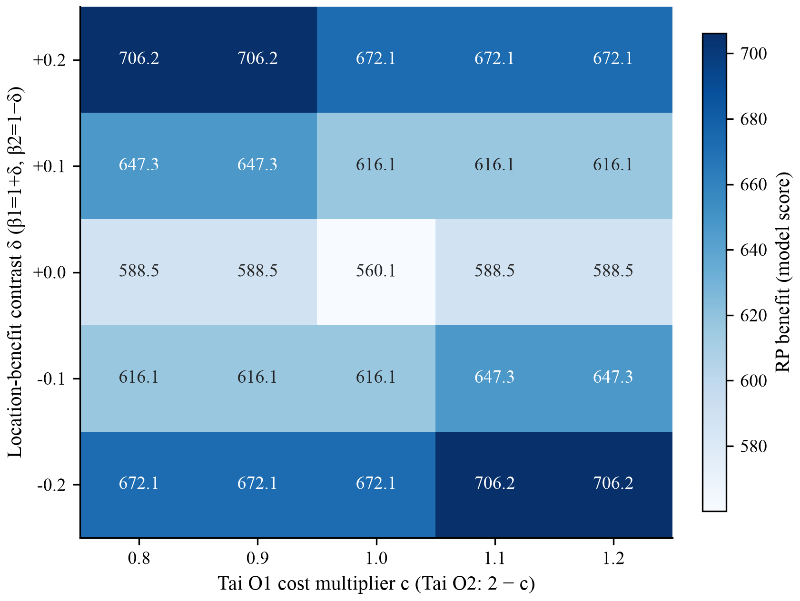
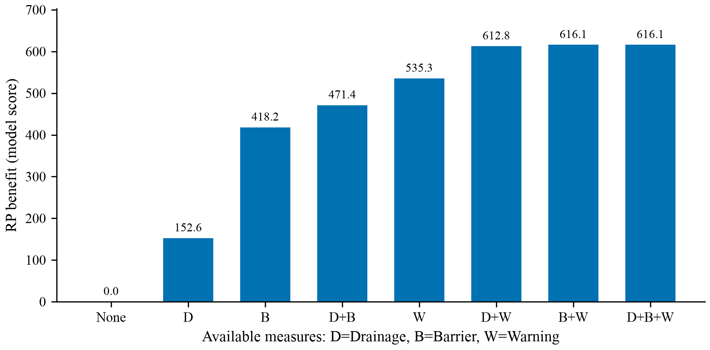
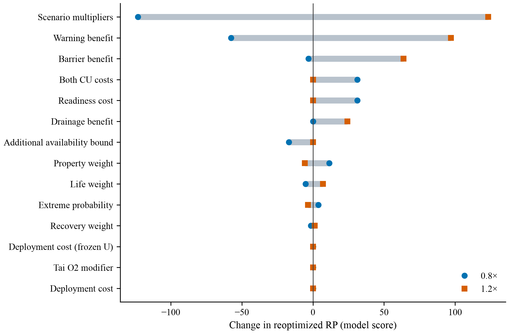
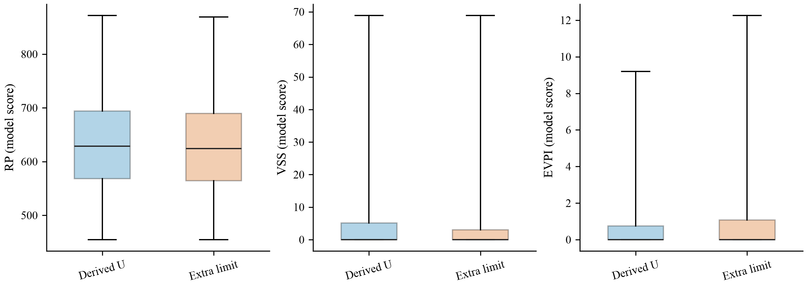
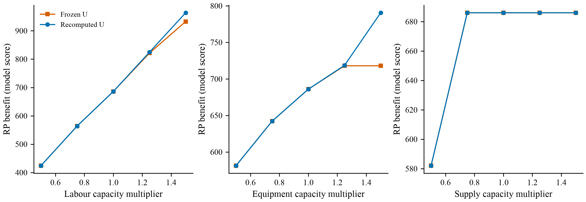

# Supplementary Methods and Results for CRISP

Companion to Revised Manuscript EN v3. Prepared 6 November 2026 (Asia/Shanghai).

## S1 Scope and evidence versions

These materials consolidate already completed analyses. No new optimization experiment, stress test, clustering fit or field observation was added during v3 preparation. The frozen 23-event main results retain EV convention A. The final reconstructed analytical sample contains 60 analyzable cyclone identities, with three additional identities pending in a 63-identity candidate frame; it is not the superseded 61-record trial. All scores below are model-score units unless a different unit is stated. Readiness and operating expenses use illustrative CU, whereas the separate capital envelope and pump price use HKD. The two currencies or scales are not combined into a monetary benefit calculation.

The supplementary comparisons were completed on 5 November 2026 in `peer_review_validation_20261105_v2`. Their design followed review of the frozen manuscript and existing results and is not a prospective preregistration. Numerical verification supports implementation of the stated models, rather than journal acceptability, empirical calibration or operational effectiveness. **CI-01 remains PARTIALLY RESOLVED / NOT FULLY CLOSED; CI-06 remains OPEN.** The 4 November CI-01 OPEN entry is a historical status and has not been overwritten.

Within the backend model, the only replaced baseline field is the conditional probability vector: (9/23, 9/23, 5/23) versus (35/60, 19/60, 6/60). Setup, capacity, deployment requirements, resource bounds, complete benefit coefficients and their component weights remain unchanged. At the scenario-construction stage, however, normalization, CRITIC and clustering were refitted. Six of the old 23 labels change; the same 60 observations projected through the frozen old rule give 43/12/5 rather than the refitted 35/19/6. The old thresholds 0.247782/0.485191 become 0.272564/0.505236, and class representatives change. The backend replay therefore attaches the new classification's conditional frequencies to the old hypothetical response-table labels. It is a controlled frequency-only sensitivity, not a recalibrated hazard-to-decision chain. Neither vector estimates annual flood probability, return periods, future probability or climate trends.

This distinction is supported by the existing [scenario-chain audit](peer_review_validation_20261105_v2/assessment/Scenario_Chain_Audit.json). The mobile RP change from 616.082500 to 634.516667 is conditional reweighting of the same illustrative scenario scores. The original RP first-stage policy remains optimal under the new base frequencies, with regret zero; the change is not evidence of realized damage reduction or a superior real policy.

Sections S2–S4 provide the additional benchmark, component and coverage comparisons summarized in the v3 methods and results. Sections S5–S8 retain the noncore frozen experiments formerly reported in v2 Sections 5.4–5.7. Their original experiment design, solution files and reports remain in [the frozen optimization outputs](../04_Results/Optimization/) and [experiment implementation](../03_Experiments/Optimization/); only the narrative location and caption numbering change here. Section S9 retains the full procurement-range tables. Sections S10–S12 retain the original event ledger, illustrative coefficient table and annual candidate flow. Numbered references in brackets refer to the accompanying manuscript reference list; linked audit files identify local evidence and are not additional literature citations.

### S1.1 Frozen experiment design retained from v2

The 21-point grid uses readiness-budget multipliers 0.50, 0.75, 1.00, 1.25, 1.50 and 2.00, and five multipliers from 0.50 to 1.50 in increments of 0.25 for each of labour, equipment and supply capacity. The 25 spatial-grid cases use β1 = 1 + δ and β2 = 1 − δ, with δ = −0.2, −0.1, 0, 0.1 and 0.2. Readiness and operating costs are multiplied by c in Tai O1 and 2 − c in Tai O2, for c = 0.8, 0.9, 1, 1.1 and 1.2. One additional case assigns opposite sector advantages to pumping and barriers, and equal Warning modifiers. The eight subsets are independently reoptimized. Shapley contributions average marginal score gains across every intervention ordering, using the same subset value function.

Four levels, 0.8, 0.9, 1.1 and 1.2, are tested for each of 14 factors. These cover intervention benefits, the three preference weights, readiness and operating expenses, the Extreme frequency, the Tai O2 modifier, an additional availability bound, both CU expenses together, operating expense with frozen bounds, and all scenario effectiveness modifiers. Weights and probabilities are renormalized after perturbation.

The joint experiment uses 200 hypothetical draws from independent Uniform(0.8, 1.2) multipliers, with NumPy PCG64 seed 20261103. Each draw perturbs intervention-specific benefit, readiness expense, operating expense and availability factors, preference weights, sector modifiers and scenario probabilities. The same draw is evaluated under recomputed resource bounds and an additional availability ceiling equal to the lesser of the recomputed bound and the floored baseline bound times the availability multiplier. The pump-stock constraint remains separate. These are designed parameter stress tests, not samples from fitted field-parameter distributions. For a feasible fixed baseline policy, regret is the reoptimized RP score minus its recourse score under that draw. Infeasible fixed-policy comparisons are kept missing.

## S2 EV conventions and complete baseline policy comparisons

### S2.1 Definitions and feasible sets

Write the operating-budget, labour, equipment and supply rows using a common index r, with positive unit requirement a_rsji and capacity C_rs. Let epsilon = 10⁻¹⁰ be the implementation's protection against flooring an exact integer slightly below its value. Scenario linking bounds are

$$
U_{sji}=\left\lfloor\min_r\frac{C_{rs}}{a_{rsji}}+\epsilon\right\rfloor. \tag{S1}
$$

The retained convention A first derives each scenario bound and then averages it. Convention B first averages primitive resources and then derives the artificial-scenario bound:

$$
U^A_{ji}=\sum_s p_s U_{sji},\qquad
U^B_{ji}=\left\lfloor\min_r\frac{\sum_s p_s C_{rs}}{\sum_s p_s a_{rsji}}+\epsilon\right\rfloor. \tag{S2}
$$

Both EV models use identical probability-weighted primitive capacities, unit requirements and complete benefit coefficients, including the already combined modifiers. Both retain binary readiness and integer deployment. A can have noninteger U; for a prepared option its effective integer limit is floor(U^A), subject also to the averaged resource rows. B's derived bound is implied by those rows when readiness is one and enforces zero deployment when readiness is zero. Thus, in the present positive-resource formulation, A adds restrictions to the mean-resource feasible set used by B. Its EV feasible set is contained in B's and EV_B ≥ EV_A. This does not imply any monotonic ordering of EEV or VSS. EV is an artificial-scenario objective and is not required to be above or below RP or EEV.

Expectation, division, minimum and floor cannot be interchanged. The disclosed A definition is not a numerical error, and B is not invalid merely because A was used in the historical code. B corresponds more directly to deriving bounds from mean primitive resources. Here B is an additional benchmark; A and all frozen reported results remain unchanged.

**Table S1. EV deployment bounds at either sector, for both legacy and inventory formulations.** All entries are deployment-unit limits.

| Conditional frequencies | Intervention | U^A | Effective integer floor(U^A) | U^B |
| --- | --- | ---: | ---: | ---: |
| 23-event | Drainage | 6.173913 | 6 | 6 |
| 23-event | Barrier | 5.956522 | 5 | 6 |
| 23-event | Warning | 6.956522 | 6 | 7 |
| 60-event | Drainage | 6.483333 | 6 | 6 |
| 60-event | Barrier | 6.383333 | 6 | 6 |
| 60-event | Warning | 7.383333 | 7 | 7 |

Source: [ev_bounds.csv](peer_review_validation_20261105_v2/runs/primary/ev_bounds.csv). Under the 23-event vector, six Barrier units in Tai O1 are allowed by B but not A: their averaged supply use is 213.652174 ≤ 220 and labour use is 255.913043 ≤ 400, with the other resource rows satisfied. Under the 60-event vector the effective integer bounds agree, giving identical EV integer feasible sets for the same current inputs. That coincidence is instance specific.

### S2.2 Baseline results and exhaustive policy enumeration

The baseline uses a 20,000 CU readiness budget; 30,000 CU operating budget and capacities of 400 labour, 60 equipment and 220 supply units in each scenario; zero initial pumps; a HKD 2,000,000 capital envelope; HKD 1,000,000 per pump; and assumed access to both sectors. The legacy formulation has no physical pump-stock constraint. RP and WS retain the original three scenarios under either EV convention. EEV fixes every EV readiness and procurement decision before scenario deployment is reoptimized.

There are 26 readiness-budget-feasible binary combinations among the six options. Legacy enumerates 26 policies per specification, and the inventory model enumerates 78 by pairing each readiness combination with n = 0, 1 or 2. Across two frequency vectors, two formulations and two conventions, all 416 fixed-policy EV trials are retained, including nonoptimal trials. A primary optimum is accepted within 10⁻⁶ score units. The reported policy is then chosen by minimum procurement, minimum readiness expense and minimum six-bit mask, with order Tai O1 Drainage/Barrier/Warning then Tai O2 Drainage/Barrier/Warning. Extra readiness does not require deployment.

**Table S2. Baseline benchmark results under A and B.** A = B means that both conventions were solved and give the same listed result; it does not assert identical models. The selected EV readiness set is Tai O1 Drainage and Warning in every row.

| Frequency and formulation | Convention | RP | WS | EV | Selected n | Selected EEV | Selected VSS | EVPI |
| --- | --- | ---: | ---: | ---: | ---: | ---: | ---: | ---: |
| 23-event legacy | A = B | 686.007826 | 686.007826 | 693.973261 | 0 | 686.007826 | 0.000000 | 0.000000 |
| 23-event inventory | A = B | 616.082500 | 622.539022 | 621.392391 | 2 | 612.844674 | 3.237826 | 6.456522 |
| 60-event legacy | A = B | 720.324917 | 720.324917 | 677.094000 | 0 | 720.324917 | 0.000000 | 0.000000 |
| 60-event inventory | A = B | 634.516667 | 639.741667 | 601.907167 | 1 | 600.203083 | 34.313583 | 5.225000 |

The complete eight rows with full precision are in [ev_summary.csv](peer_review_validation_20261105_v2/runs/primary/ev_summary.csv). The raw 60-event legacy EVPI is −1.1368683772161603 × 10⁻¹³ and is displayed as zero here; the original CSV is preserved. WS ≥ RP ≥ EEV holds to 10⁻⁶ in every baseline specification.

Define Y0 = {Tai O1 Drainage, Tai O1 Warning} and Y+ = Y0 ∪ {Tai O2 Warning}. These are the complete EV-optimal readiness sets, with procurement as below; primary-optimal sets agree under A and B.

**Table S3. Complete EV-optimal baseline policy sets and original-scenario evaluation.** Each row contains two policies, one with Y0 and one with Y+.

| Frequency and formulation | EV-optimal readiness | n | EEV | VSS |
| --- | --- | ---: | ---: | ---: |
| 23-event legacy | Y0 or Y+ | 0 | 686.007826 | 0.000000 |
| 23-event inventory | Y0 or Y+ | 2 | 612.844674 | 3.237826 |
| 60-event legacy | Y0 or Y+ | 0 | 720.324917 | 0.000000 |
| 60-event inventory | Y0 or Y+ | 1 | 600.203083 | 34.313583 |
| 60-event inventory | Y0 or Y+ | 2 | 626.497667 | 8.019000 |

Source: [ev_optimal_policies.csv](peer_review_validation_20261105_v2/runs/primary/ev_optimal_policies.csv). The 60-event inventory baseline therefore has four EV-optimal policies, EEV in [600.203083, 626.497667] and VSS in [8.019000, 34.313583]. Its selected n = 1 is a secondary-rule outcome, not a unique requirement of the EV objective. The range is ambiguity among EV-optimal policies, not a confidence interval.

**Table S4. Fixed-policy EV changes when B replaces A.** Counts compare every retained fixed policy within the same formulation and frequency vector.

| Frequency and formulation | Paired fixed policies | Policies with changed EV | Maximum EV_B − EV_A |
| --- | ---: | ---: | ---: |
| 23-event legacy | 26 | 6 | 78.137065 |
| 23-event inventory | 78 | 35 | 78.137065 |
| 60-event legacy | 26 | 0 | 0.000000 |
| 60-event inventory | 78 | 0 | 0.000000 |

Source: [paired fixed-policy comparison](peer_review_validation_20261105_v2/runs/primary/ev_fixed_policy_convention_comparison.csv). For example, mask 4 with n = 0 prepares only Tai O1 Warning; B permits seven units at the 23-event frequencies, while A permits six. Baseline optimal policies happen not to be affected. These eight specifications establish baseline agreement, not general equivalence or B-based validation of the old 555 configurations. The full enumeration is [ev_all_policy_trials.csv](peer_review_validation_20261105_v2/runs/primary/ev_all_policy_trials.csv).

## S3 Controlled model components

### S3.1 Inputs and switches

These 24 RP specifications keep all benefit and primitive resource coefficients, readiness budget, zero initial stock, intervention domains and deployment integrality identical within each frequency/capital panel. The original capital envelope is HKD 2,000,000. The separate HKD 6,500,000 panel is a hypothetical mechanism check selected before the supplementary execution, not a measured budget or procurement recommendation. Its noninteger capital-to-price ratio also tests procurement relaxation beyond an integer ratio. Continuous procurement has the unrounded upper bound K^cap/C^cap, equal to 2 or 6.5. Deployment remains integer throughout.

**Table S5. Controlled component definitions.** D denotes Drainage. All omitted resource, readiness and deployment constraints remain unchanged.

| Specification | Stock constraint in each scenario | Procurement n | Accessible sectors | Direct reference |
| --- | --- | --- | --- | --- |
| F0 | No physical inventory row | Continuous | Both | Resource-constrained unrestricted-stock relaxation |
| F1 | x_sjD ≤ N0 + n separately for each j | Continuous | Both | F0, adding a per-sector stock ceiling |
| F2 | Sum_j x_sjD ≤ N0 + n | Continuous | Both | F1, replacing replicated ceilings by shared total |
| F3 | Sum_j x_sjD ≤ N0 + n | Integer | Both | F2, changing only procurement integrality |
| A1 | Shared total as F3 | Integer | Tai O1 only | F3, changing only access |
| A2 | Shared total as F3 | Integer | Tai O2 only | F3, changing only access |

F0 retains the capital row and n but disconnects procurement from deployment. Its secondary rule selects n = 0; this is a relaxation upper bound, not an implementable policy with no physical pumps. F1 intentionally duplicates the same stock at the two sectors and is a structural counterfactual. F0 → F1 → F2 → F3 are nested restrictions. A1 and A2 are each restrictions of F3; neither access branch is generally a subset of the other.

**Table S6. All controlled component RP results.** The 6.5 million HKD panels are hypothetical. Every cell was OPTIMAL.

| Specification | 23-event, HKD 2m | 60-event, HKD 2m | 23-event, hypothetical HKD 6.5m | 60-event, hypothetical HKD 6.5m |
| --- | ---: | ---: | ---: | ---: |
| F0 unrestricted stock | 686.007826 | 720.324917 | 686.007826 | 720.324917 |
| F1 replicated stock, continuous n | 616.082500 | 634.516667 | 686.007826 | 720.324917 |
| F2 shared stock, continuous n | 616.082500 | 634.516667 | 686.007826 | 720.324917 |
| F3 shared stock, integer n | 616.082500 | 634.516667 | 686.007826 | 720.324917 |
| A1 Tai O1 pump access only | 616.082500 | 634.516667 | 686.007826 | 720.324917 |
| A2 Tai O2 pump access only | 616.082500 | 634.516667 | 632.748696 | 659.359750 |

Source: [component_summary.csv](peer_review_validation_20261105_v2/runs/primary/component_summary.csv), with full-precision procurement and readiness choices. In the HKD 2m panels, F1–F3 and both access branches select no pumps and prepare Tai O1 Barrier and Warning. F0 prepares Tai O1 Drainage and Warning but, as explained above, is a relaxation. The finite-stock RP contraction relative to F0 is 69.925326 at the 23-event frequencies and 85.808250 at the 60-event frequencies. These differences describe a smaller achievable model-score set under limited physical stock. They are neither deterioration of numerical performance nor observed losses of flood protection.

The pure replicated-to-shared contrast F1 → F2 has zero optimal-score increment in all four panels. The F0 → F2 difference must not be attributed entirely to shared rather than duplicated stock. In the hypothetical HKD 6.5m panels, F1–F3 and A1 purchase six pumps and prepare Tai O1 Drainage and Warning, reaching F0's RP. A2 also purchases six pumps but prepares Tai O1 Warning and Tai O2 Drainage; its opportunity costs relative to F3 are 53.259130 and 60.965167. The original 2m access branches have zero effect because their selected RP policies do not deploy pumps. No field access or transport effect is estimated.

### S3.2 Distinct shared and replicated feasible sets

Zero difference in optimal RP does not make the shared-stock row redundant. A retained witness prepares Drainage in both sectors for 17,000 CU, purchases two pumps for HKD 2m and deploys two Drainage units in each sector in each scenario. All linking and primitive resource rows are satisfied:

**Table S7. Resource use of the replicated-stock witness.** There are four simultaneous Drainage units in every row.

| Scenario | Operating expense, CU of 30,000 | Labour of 400 | Equipment of 60 | Supply of 220 |
| --- | ---: | ---: | ---: | ---: |
| Moderate | 10,400 | 112 | 32 | 72 |
| Severe | 12,400 | 136 | 40 | 88 |
| Extreme | 15,600 | 168 | 48 | 108 |

F1 satisfies 2 ≤ 2 at each sector, but F2 violates the shared total because 4 > 2. The feasible sets differ even though these instances' optima do not require the violating allocation. This witness is an arithmetic feasibility check, not a new optimization experiment or a deployment recommendation. Its [row-level certificate](peer_review_validation_20261105_v2/runs/primary/shared_inventory_feasible_set_witness.json) is retained.

### S3.3 Procurement integrality equivalence for the present structure

For any feasible solution with continuous n, set

$$
M=\max_s\sum_j x_{sjD},\qquad n^*=\max\{0,M-N^0\}. \tag{S3}
$$

Because x and N0 are integer, n* is integer. The shared-stock inequalities imply n* ≤ n. Replacing n by n* preserves every readiness and deployment decision, satisfies the capital ceiling with no larger expense, and leaves the primary score unchanged. A minimum-procurement secondary objective can also choose n*. Thus F2 and F3 have identical feasible projections onto (y,x) and identical RP optima in the present model. Their complete feasible sets in n differ.

The four numerical panels support this structural result, including the noninteger capital/price ratio 6.5. The argument depends on procurement entering only the capital ceiling, shared inventory and secondary objective, with integer deployment and initial stock. Different purchase logic, fractional deployment, nonlinear procurement relationships or other constraints require a new argument. Relaxing deployment integrality at the same time would test a different question and could not identify a procurement-integrality effect.

Only RP was evaluated for the component specifications. Their WS, EV, EEV and VSS were not computed; baseline information-value findings are not transferred to these changed feasible sets.

## S4 Hypothetical minimum geographic coverage

The comparison adds the following actual-deployment condition to the original inventory baseline:

$$
\sum_i x_{sji}\ge k\quad\text{for every scenario }s\text{ and each sector }j. \tag{S4}
$$

The lower bound counts abstract intervention packages. Drainage, Barrier and Warning packages do not provide equivalent service. Accordingly, k is not population coverage, protected volume, avoided damage, welfare or a calibrated equity standard. It is imposed on actual x rather than on readiness y. All original coefficients, resources, capital and access remain unchanged. The already completed primary contrast is k = 1; k = 2 is a specified intensity comparison, and k = 6 is an infeasibility handling control.

**Table S8. Minimum geographic deployment comparisons.** Opportunity cost is RP(k = 0) − RP(k), so positive values indicate foregone model score from satisfying the assumed rule.

| Frequency vector | k in each sector and scenario | Status | RP | Opportunity cost | New pumps |
| --- | ---: | --- | ---: | ---: | ---: |
| 23-event | 0 | OPTIMAL | 616.082500 | 0.000000 | 0 |
| 23-event | 1 | OPTIMAL | 601.875761 | 14.206739 | 0 |
| 23-event | 2 | OPTIMAL | 587.669022 | 28.413478 | 0 |
| 23-event | 6 | INFEASIBLE | Not defined | Not applicable | Not applicable |
| 60-event | 0 | OPTIMAL | 634.516667 | 0.000000 | 0 |
| 60-event | 1 | OPTIMAL | 620.836333 | 13.680333 | 0 |
| 60-event | 2 | OPTIMAL | 607.156000 | 27.360667 | 0 |
| 60-event | 6 | INFEASIBLE | Not defined | Not applicable | Not applicable |

Source: [coverage_summary.csv](peer_review_validation_20261105_v2/runs/primary/coverage_summary.csv). Positive opportunity costs above are the negatives of the CSV's signed `delta_vs_no_coverage`. Infeasible objectives are left undefined, not filled with zero.

At k = 1 or 2, the returned policy prepares Tai O1 Barrier and Warning plus Tai O2 Warning for 18,500 CU and purchases no pumps. The returned deployment shifts k Warning packages from Tai O1 to Tai O2 in every scenario while retaining the Barrier deployment in Tai O1. The two frequency vectors give identical returned allocations; their weighted scores differ. All primary-optimal deployments were not enumerated, so uniqueness is not claimed.

**Table S9. Returned geographic deployment, under either frequency vector.** Each entry reports Tai O1 Barrier / Tai O1 Warning ; Tai O2 Warning. All Drainage deployment is zero.

| k | Moderate | Severe | Extreme |
| --- | --- | --- | --- |
| 0 | 6 / 4 ; 0 | 3 / 5 ; 0 | 1 / 5 ; 0 |
| 1 | 6 / 3 ; 1 | 3 / 4 ; 1 | 1 / 4 ; 1 |
| 2 | 6 / 2 ; 2 | 3 / 3 ; 2 | 1 / 3 ; 2 |

Source: [coverage_deployment.csv](peer_review_validation_20261105_v2/runs/primary/coverage_deployment.csv). Tai O1 totals are 10 − k, 8 − k and 6 − k, meeting its own lower bound at k = 1 or 2. At k = 6, the Extreme scenario requires at least 12 total packages. Its minimum labour coefficient is 42 per package, so even the relaxed labour requirement is at least 12 × 42 = 504 > 400. This certifies infeasibility under either frequency vector independently of objective values. The solver's INFEASIBLE status, IIS files and independent resource certificates are retained.

These RP differences quantify the model opportunity cost of the hypothetical deployment rule. They are not measured protection losses or a social cost of fairness. No new benefit coefficients were fitted, and no WS/EV/EEV/VSS comparison was performed for the coverage-constrained variants.

## S5 Frozen spatial heterogeneity

The 25-cell grid in Figure S1 yields RP scores from 560.075000 to 706.154348. Choices respond to both assumed sector benefits and CU costs. For example, reversing the baseline modifiers from β1 = 1.1 and β2 = 0.9 to β1 = 0.9 and β2 = 1.1, with equal costs, moves Barrier and Warning to Tai O2 while preserving RP = 616.082500. At δ = 0.1 and c = 0.9, all three measures become affordable in Tai O1, two pumps are purchased and RP rises to 647.308152.

The additional intervention-specific contrast gives pumping an advantage in Tai O1, barriers an advantage in Tai O2 and equal Warning modifiers. It selects Warning in Tai O1 and Barrier in Tai O2 without purchasing pumps, giving RP = 585.235870, VSS = 15.741957 and EVPI = 1.506522. In a symmetry tie, the disclosed encoding can determine the selected sector. None of these modifiers is inferred from the census population ratio.

**Figure S1. Hypothetical spatial heterogeneity.** Reoptimized RP over 25 combinations of β1 = 1 + δ, β2 = 1 − δ, and readiness and operating cost multipliers c in Tai O1 and 2 − c in Tai O2. The pump capital envelope remains HKD 2 million. Grid values are model scores. The additional intervention-specific case is described in the text. Source: frozen 23-event experiment outputs and verification records (conditional frequencies 9/23, 9/23, 5/23 before stated perturbations).

## S6 Frozen intervention subsets and one factor perturbations

Figure S2 reports all eight reoptimized intervention subsets. The empty subset yields zero. Drainage alone yields 152.570000, Barrier alone 418.221196, and Warning alone 535.332935. Drainage plus Barrier yields 471.402609, Drainage plus Warning 612.844674, and Barrier plus Warning 616.082500. Allowing all three measures also yields 616.082500, because the baseline optimum does not use pumping.

The leave-one-out losses for Drainage, Barrier and Warning are 0.000000, 3.237826 and 144.679891. Their Shapley contributions are 72.638859, 207.083370 and 336.360272, which sum to RP. Drainage has positive contribution in other coalitions despite a zero loss when removed from the full baseline choice set. These are contributions to a stipulated model value function, not estimates of causal intervention effects or lives saved.

**Figure S2. Intervention ablation.** All eight available subsets of Drainage D, Barrier B and Warning W are reoptimized under the same inventory baseline. Values are RP scores, rather than observed effects. Source: frozen 23-event experiment outputs and verification records (conditional frequencies 9/23, 9/23, 5/23 before stated perturbations).

The 56 one-factor conditions show substantial dependence on benefit assumptions and readiness expense (Figure S3). Scaling all scenario effectiveness modifiers by 0.8 and 1.2 gives RP = 492.866000 and 739.299000 while retaining the baseline policy. Reducing readiness costs to 0.9 times baseline makes all three measures affordable and changes the selected policy to two pumps plus readiness for all measures in Tai O1, with RP = 647.308152. Changing operating costs alone by the tested ±20% endpoints leaves RP at 616.082500. Such flat responses apply only to this resource regime.

**Figure S3. One-factor endpoint effects.** Differences from the inventory-baseline RP for the 0.8 and 1.2 endpoints of each of 14 factors. Each factor also has 0.9 and 1.1 conditions. Preference weights and probabilities are renormalized. Segments join outcomes and do not indicate uncertainty intervals. The frozen-bound condition is an explicit control. Source: frozen 23-event experiment outputs and verification records (conditional frequencies 9/23, 9/23, 5/23 before stated perturbations).

## S7 Frozen joint parameter stress tests

The derived-bound versus additional-availability comparison changes the resource/availability control. It is distinct from the A/B EV definitions in Section S2; these frozen experiments retain convention A for EV.

Table S10 and Figure S4 describe 200 paired hypothetical draws for each bound convention. Under derived bounds, the baseline Barrier-plus-Warning policy in Tai O1 is selected in 76 of 200 draws (38.0%), and Drainage plus Warning there with two new pumps in 60 draws (30.0%). Six distinct selected readiness-and-procurement policies occur. Under the additional availability ceiling, 12 distinct policies occur and the baseline policy is selected in 67 draws (33.5%). Positive VSS above 10⁻⁶ occurs in 60 derived-bound draws and 62 additional-ceiling draws.

**Table S10. Joint stress-test quantiles in model-score units.**

| Bound convention | Metric | 2.5th percentile | Median | 97.5th percentile |
| --- | --- | ---: | ---: | ---: |
| Derived bounds | RP | 469.792548 | 628.805630 | 811.543295 |
| Derived bounds | VSS | 0.000000 | 0.000000 | 31.948876 |
| Derived bounds | EVPI | 0.000000 | 0.000000 | 7.109179 |
| Additional availability ceiling | RP | 465.300577 | 624.199544 | 811.515040 |
| Additional availability ceiling | VSS | 0.000000 | 0.000000 | 38.005348 |
| Additional availability ceiling | EVPI | 0.000000 | 0.000000 | 7.881676 |

The fixed baseline policy is feasible in all 200 draws under each convention. Its median regret is 15.182290 with derived bounds and 17.654210 with the additional ceiling. These comparisons reoptimize only recourse for the fixed policy and all decisions for the draw-specific optimum. Separate optima for 200 draws do not define a single robust policy. Neither the table's quantiles nor the figure's distributions are confidence intervals for measured benefits. Tiny negative numerical residuals below the verification tolerance are displayed as zero.

**Figure S4. Paired joint parameter stress tests.** RP, selected-policy VSS and EVPI across 200 draws per convention, using seed 20261103 and the same multipliers within each pair. Boxes show the interquartile range, horizontal lines the median and whiskers the minimum and maximum. The figure's whiskers differ from the 2.5th–97.5th percentiles in Table S10. Source: frozen 23-event experiment outputs and verification records (conditional frequencies 9/23, 9/23, 5/23 before stated perturbations).

## S8 Frozen legacy bounds and capacity grids

Recomputing resource-derived bounds changes at least one benchmark metric at five of the legacy 21 points (Table S11). All six readiness-budget points are unaffected by the bound correction. An independent rerun through the retained legacy Step 5–7 entry also matches the corrected 21-point results. This comparison isolates the bound correction and does not include the new physical stock constraint.

**Table S11. Legacy points affected by recomputation of linking bounds.**

| Resource | Multiplier | Old RP | Corrected RP | Old EVPI | Corrected EVPI |
| --- | ---: | ---: | ---: | ---: | ---: |
| Labour | 1.25 | 821.392717 | 824.471522 | 0.000000 | 0.000000 |
| Labour | 1.50 | 932.520217 | 963.516304 | 1.847283 | 1.171739 |
| Equipment | 1.25 | 718.010652 | 718.591739 | 0.000000 | 0.000000 |
| Equipment | 1.50 | 718.010652 | 790.526957 | 0.000000 | 0.000000 |
| Supply | 1.50 | 686.007826 | 686.007826 | 0.000000 | 14.419565 |

The coincident Supply RP curves in Figure S5 conceal a change in WS, from 686.007826 to 700.427391, and hence in EVPI. Increasing equipment capacity to 90 units gives corrected legacy RP = 790.526957, replacing the old plateau at 718.010652. At labour capacity 600, corrected legacy RP = 963.516304 replaces 932.520217.

**Figure S5. Legacy resource-bound correction.** Frozen versus recomputed linking bounds at five levels per resource. This figure concerns the legacy model without explicit pump stock. Identical Supply RP curves do not imply identical WS or EVPI, as Table S11 shows. Source: frozen 23-event experiment outputs and verification records (conditional frequencies 9/23, 9/23, 5/23 before stated perturbations).

The current inventory model is also rerun over the same 21 conditions. With readiness budgets of 25,000, 30,000 or 40,000 CU, it gives RP = 647.308152 and selected-policy VSS = 34.463478, rather than the legacy values 714.416522 and 28.408696. At labour capacity 600, current RP = 902.652826 and VSS = 46.735652. Increasing equipment capacity above its baseline 60 units leaves current RP at 616.082500 through the tested 90-unit endpoint. At supply capacity 330, current RP = 663.386087 and EVPI = 1.907065. These results belong to a different feasible set from the legacy correction in Table S11 and are not interchangeable with it.

## S9 Detailed procurement and inventory sensitivity

All procurement-range comparisons in this section use the retained convention A. The local A/B agreement in Section S2 does not establish agreement across either procurement grid, which was not recomputed under B.

### S9.1 Frozen 23 event conditional frequencies

main-text Figure 2 and Table S12 hold the illustrative coefficients, zero initial stock, approximate HKD 1 million unit price and assumed access fixed while changing the capital envelope. At procurement limits zero and one, the RP score is 616.082500 and VSS is zero. At a limit of two, the RP score is unchanged, but EV prepares a pumping policy that performs less well under the original scenarios. The enumeration finds two primary-optimal EV first-stage policies at this baseline, both with EEV = 612.844674. Its positive VSS is therefore invariant to EV tie choice within the audited optimal set.

**Table S12. Procurement sensitivity and EV policy ranges in model-score units.**

| Maximum new pumps | RP new pumps | RP | Selected EEV | Selected VSS | VSS range across all EV optima |
| --- | ---: | ---: | ---: | ---: | --- |
| 0 | 0 | 616.082500 | 616.082500 | 0.000000 | 0.000000–0.000000 |
| 1 | 0 | 616.082500 | 616.082500 | 0.000000 | 0.000000–0.000000 |
| 2 | 0 | 616.082500 | 612.844674 | 3.237826 | 3.237826–3.237826 |
| 3 | 3 | 655.274783 | 612.844674 | 42.430109 | 0.000000–42.430109 |
| 4 | 4 | 656.501522 | 612.844674 | 43.656848 | 0.000000–43.656848 |
| 6 | 6 | 686.007826 | 657.728261 | 28.279565 | 0.000000–28.279565 |
| 8 | 6 | 686.007826 | 657.728261 | 28.279565 | 0.000000–28.279565 |
| 12 | 6 | 686.007826 | 657.728261 | 28.279565 | 0.000000–28.279565 |
| 20 | 6 | 686.007826 | 657.728261 | 28.279565 | 0.000000–28.279565 |

Selected EEV and VSS apply the stated minimum-procurement, minimum-readiness and encoding rules. The shaded range in main-text Figure 2 covers primary EV optima before those rules.

At a limit of three, RP switches to Drainage and Warning. At the tested limit of six, it purchases six pumps and reaches the legacy RP score. Higher tested limits leave that choice and score unchanged. With limits of at least six, the selected EV policy purchases five pumps, producing EEV = 657.728261, whereas some equally EV-optimal reserve-stock policies attain EEV = RP. The corresponding VSS ranges include zero. Six is a threshold in this hypothetical grid, rather than a recommendation for Tai O procurement.

The existing-stock experiment sets the procurement envelope to zero. Available stocks of zero, one, two, four and eight pumps yield RP scores of 616.082500, 616.082500, 616.082500, 656.501522 and 686.007826, respectively. These are alternative assumed stocks. At the baseline HKD 2 million envelope, increasing unit price to 1.1 or 1.2 times the reference reduces the integer purchase limit to one: RP remains unchanged, while VSS and EVPI become zero. Mainland-only or no pump access also leaves the no-pump RP baseline unchanged and makes both information-value measures zero. This does not establish that real access restrictions are inconsequential.

### S9.2 Reconstructed 60 event conditional frequencies

The final audit enumerates 1,716 feasible first-stage policies over ten case specifications and records 1,808 audit solves. Table S13 reports the nine inventory/procurement cases; the legacy case has two EV-optimal policies and VSS = 0 for both. The baseline at a two-pump limit has four EV optima, giving EEV from 600.203083 to 626.497667 and VSS from 8.019000 to 34.313583. Positive baseline VSS persists across that audited set, but its magnitude is not a unique output of the primary EV objective.

**Table S13. EV policy ranges with the 60-event conditional frequencies.** RP, EEV and VSS are model-score units; limits and counts are integers. Ranges cover all audited primary EV-optimal first-stage policies before the secondary choice rules.

| Maximum new pumps | RP | EV-optimal policies | EEV range | VSS range |
| --- | ---: | ---: | --- | --- |
| 0 | 634.516667 | 2 | 634.516667–634.516667 | 0.000000–0.000000 |
| 1 | 634.516667 | 2 | 600.203083–600.203083 | 34.313583–34.313583 |
| 2 | 634.516667 | 4 | 600.203083–626.497667 | 8.019000–34.313583 |
| 3 | 675.389917 | 2 | 675.389917–675.389917 | 0.000000–0.000000 |
| 4 | 676.778667 | 4 | 675.389917–676.778667 | 0.000000–1.388750 |
| 6 | 720.324917 | 8 | 675.389917–720.324917 | 0.000000–44.935000 |
| 8 | 720.324917 | 12 | 675.389917–720.324917 | 0.000000–44.935000 |
| 12 | 720.324917 | 20 | 675.389917–720.324917 | 0.000000–44.935000 |
| 20 | 720.324917 | 36 | 675.389917–720.324917 | 0.000000–44.935000 |

Source: CI-01 backend_probability60/summary.csv and ev_policy_tie_ranges.csv. The two-pump row is the mobile baseline. The selected EEV is the lower endpoint in these rows; this follows the stated secondary choice rules for these instances and is not a general property. At limits of at least six, the selected EV policy purchases three pumps, while an equally EV-optimal policy purchasing six attains EEV = RP. The tested zero-VSS possibilities therefore remain material. A solver's returned readiness or procurement vector is not asserted to be the only admissible optimal policy.

## S10 Original event data and source ledger

**Table S14. The 23 retained event vectors and registered sources.** R is event-window maximum daily rainfall, W is maximum sea level and S retains the HKO-reported event maximum above astronomical tide. E020 (Man-yi, marked *) is the 0.66 m sea level rise due to the combined effect of the northeast monsoon and Man-yi, rather than a separated pure-typhoon surge. Event names are shortened for layout. R11, HKA and R12 identify the rainfall station; every registered tide station is Shek Pik. Rain and Tide retain the original registered URLs. For E018–E023, whose registered tide links were inaccessible, Verified points to the recovered official table or monthly-summary page. All rainfall vectors agree with the archived RF tables. Complete official tables corroborate all 23 numerical tide pairs, including the five recovered sources. The CI-01 database cross-check nevertheless leaves Yagi's S-peak date unresolved (5 versus 6 September 2024 at 01:10); its extrema-only inclusion does not verify peak timing. The table preserves historical anchors, five of which differ from the new highest-signal anchor (main-text Section 4.3). Numerical corroboration does not certify historical selection, station-decision history, instrument calibration or local inundation.

| ID and event date | Event | Rain station | R, mm/day | W, mCD | S, m | Registered sources |
| --- | --- | --- | ---: | ---: | ---: | --- |
| E001 2017-06-12 | Merbok | R11 | 117.0 | 2.57 | 0.28 | [Rain](https://www.hko.gov.hk/cis/aws/individual_day/daily_R11_2017.xml), [Tide](https://www.hko.gov.hk/en/publica/tc/tc2017/table314.html) |
| E002 2017-07-23 | Roke | R11 | 13.5 | 2.75 | 0.22 | [Rain](https://www.hko.gov.hk/cis/aws/individual_day/daily_R11_2017.xml), [Tide](https://www.hko.gov.hk/en/publica/tc/tc2017/table323.html) |
| E003 2017-08-23 | Hato | R11 | 86.0 | 3.91 | 1.54 | [Rain](https://www.hko.gov.hk/cis/aws/individual_day/daily_R11_2017.xml), [Tide](https://www.hko.gov.hk/en/publica/tc/tc2017/table334.html) |
| E004 2017-08-27 | Pakhar | HKA | 136.2 | 2.38 | 0.67 | [Rain](https://www.hko.gov.hk/cis/aws/individual_day/daily_HKA_2017.xml), [Tide](https://www.hko.gov.hk/en/publica/tc/tc2017/table344.html) |
| E005 2017-10-15 | Khanun | R11 | 45.0 | 2.88 | 1.04 | [Rain](https://www.hko.gov.hk/cis/aws/individual_day/daily_R11_2017.xml), [Tide](https://www.hko.gov.hk/en/publica/tc/tc2017/table374.html) |
| E006 2018-09-16 | Mangkhut | R11 | 277.5 | 3.89 | 2.34 | [Rain](https://www.hko.gov.hk/cis/aws/individual_day/daily_R11_2018.xml), [Tide](https://www.hko.gov.hk/en/publica/tc/tc2018/table355.html) |
| E007 2019-07-31 | Wipha | HKA | 104.8 | 3.20 | 0.64 | [Rain](https://www.hko.gov.hk/cis/aws/individual_day/daily_HKA_2019.xml), [Tide](https://www.hko.gov.hk/en/publica/tc/tc2019/table324.html) |
| E008 2020-08-19 | Higos | R11 | 96.5 | 3.00 | 0.71 | [Rain](https://www.hko.gov.hk/cis/aws/individual_day/daily_R11_2020.xml), [Tide](https://www.hko.gov.hk/en/publica/tc/tc2020/table334.html) |
| E009 2020-10-13 | Nangka | R11 | 23.0 | 2.72 | 0.74 | [Rain](https://www.hko.gov.hk/cis/aws/individual_day/daily_R11_2020.xml), [Tide](https://www.hko.gov.hk/en/publica/tc/tc2020/table344.html) |
| E010 2021-10-09 | Lionrock | R11 | 230.5 | 2.91 | 0.56 | [Rain](https://www.hko.gov.hk/cis/aws/individual_day/daily_R11_2021.xml), [Tide](https://www.hko.gov.hk/en/publica/tc/tc2021/table354.html) |
| E011 2021-10-13 | Kompasu | R11 | 149.5 | 3.38 | 1.36 | [Rain](https://www.hko.gov.hk/cis/aws/individual_day/daily_R11_2021.xml), [Tide](https://www.hko.gov.hk/en/publica/tc/tc2021/table364.html) |
| E012 2022-07-02 | Chaba | R11 | 122.5 | 2.94 | 0.70 | [Rain](https://www.hko.gov.hk/cis/aws/individual_day/daily_R11_2022.xml), [Tide](https://www.hko.gov.hk/en/publica/tc/tc2022/table314.html) |
| E013 2022-08-25 | Ma-on | R12 | 42.0 | 2.94 | 0.70 | [Rain](https://www.hko.gov.hk/cis/aws/individual_day/daily_R12_2022.xml), [Tide](https://www.hko.gov.hk/en/publica/tc/tc2022/table344.html) |
| E014 2022-11-02 | Nalgae | R11 | 43.0 | 2.99 | 0.70 | [Rain](https://www.hko.gov.hk/cis/aws/individual_day/daily_R11_2022.xml), [Tide](https://www.hko.gov.hk/en/publica/tc/tc2022/table364.html) |
| E015 2023-07-17 | Talim | R11 | 73.0 | 3.01 | 0.63 | [Rain](https://www.hko.gov.hk/cis/aws/individual_day/daily_R11_2023.xml), [Tide](https://www.hko.gov.hk/en/publica/tc/tc2023/table314.html) |
| E016 2023-09-01 | Saola | R11 | 105.0 | 3.07 | 0.72 | [Rain](https://www.hko.gov.hk/cis/aws/individual_day/daily_R11_2023.xml), [Tide](https://www.hko.gov.hk/en/publica/tc/tc2023/table335.html) |
| E017 2023-10-08 | Koinu | HKA | 351.9 | 2.65 | 0.58 | [Rain](https://www.hko.gov.hk/cis/aws/individual_day/daily_HKA_2023.xml), [Tide](https://www.hko.gov.hk/en/publica/tc/tc2023/table354.html) |
| E018 2024-09-05 | Yagi | R11 | 80.0 | 2.52 | 0.57 | [Rain](https://www.hko.gov.hk/cis/aws/individual_day/daily_R11_2024.xml), [Tide](https://www.hko.gov.hk/en/informtc/yagi24/stormsurge.html), [Verified](https://www.hko.gov.hk/en/publica/tc/tc2024/table334.html) |
| E019 2024-11-14 | Toraji | R11 | 22.0 | 2.64 | 0.40 | [Rain](https://www.hko.gov.hk/cis/aws/individual_day/daily_R11_2024.xml), [Tide](https://www.hko.gov.hk/en/informtc/toraji24/stormsurge.html), [Verified](https://www.hko.gov.hk/en/publica/tc/tc2024/table364.html) |
| E020 2024-11-18 | Man-yi* | R11 | 77.0 | 3.37 | 0.66 | [Rain](https://www.hko.gov.hk/cis/aws/individual_day/daily_R11_2024.xml), [Tide](https://www.hko.gov.hk/en/informtc/man-yi24/stormsurge.html), [Verified](https://www.hko.gov.hk/en/publica/tc/tc2024/table373.html) |
| E021 2025-07-20 | Wipha | R11 | 138.5 | 2.66 | 1.10 | [Rain](https://www.hko.gov.hk/cis/aws/individual_day/daily_R11_2025.xml), [Tide](https://www.hko.gov.hk/en/informtc/wipha25/stormsurge.html), [Verified](https://www.hko.gov.hk/en/publica/mws/files/mws202507.pdf#page=45) |
| E022 2025-09-08 | Tapah | R11 | 121.5 | 2.93 | 0.62 | [Rain](https://www.hko.gov.hk/cis/aws/individual_day/daily_R11_2025.xml), [Tide](https://www.hko.gov.hk/en/informtc/tapah25/stormsurge.html), [Verified](https://www.hko.gov.hk/en/publica/mws/files/mws202509.pdf#page=32) |
| E023 2025-09-24 | Ragasa | R11 | 238.5 | 3.60 | 1.55 | [Rain](https://www.hko.gov.hk/cis/aws/individual_day/daily_R11_2025.xml), [Tide](https://www.hko.gov.hk/en/informtc/ragasa25/stormsurge.html), [Verified](https://www.hko.gov.hk/en/publica/mws/files/mws202509.pdf#page=71) |

The model inputs preserve these vectors so that the reviewed results remain traceable. Any corrected event value or inclusion rule requires rerunning normalization, weighting, scenario construction and all affected optimization comparisons. The current revision does not substitute unverified replacement values.

## S11 Scenario dependent illustrative requirements

**Table S15. Per-unit coefficients shared by both sectors in the baseline.** c is CU operating expense; labour, equipment and supply are abstract units; α is the scenario effectiveness modifier. U is the resource-derived linking bound, separate from physical pump stock. A Drainage unit is assumed to represent one simultaneous pump assignment. Barrier and Warning remain hypothetical packages.

| Scenario | Measure | c, CU | Labour | Equipment | Supply | α | U |
| --- | --- | ---: | ---: | ---: | ---: | ---: | ---: |
| Moderate | Drainage | 2,600 | 28 | 8 | 18 | 0.90 | 7 |
| Moderate | Barrier | 2,200 | 36 | 5 | 30 | 0.85 | 7 |
| Moderate | Warning | 1,400 | 45 | 2 | 10 | 0.90 | 8 |
| Severe | Drainage | 3,100 | 34 | 10 | 22 | 1.00 | 6 |
| Severe | Barrier | 2,650 | 43 | 6 | 36 | 1.00 | 6 |
| Severe | Warning | 1,700 | 54 | 3 | 12 | 1.00 | 7 |
| Extreme | Drainage | 3,900 | 42 | 12 | 27 | 0.95 | 5 |
| Extreme | Barrier | 3,300 | 54 | 8 | 45 | 1.10 | 4 |
| Extreme | Warning | 2,100 | 68 | 3 | 15 | 1.15 | 5 |

Together with main-text Table 5, preference weights (0.5, 0.3, 0.2), sector modifiers (1.1, 0.9), and the stated budgets and stock assumptions, these coefficients define the baseline. No coefficient in this table is claimed as a measured per-pump or per-package field requirement.

## S12 Reconstructed local warning frame and provenance

**Table S16. Annual candidate flow under the new retrospective protocol.** A warning group can cover two cyclone identities; data unavailability or unresolved attribution is pending rather than substantive exclusion.

| Year | Warning groups | Cyclone identities | Original sample | Analyzable identities | Pending identities |
| --- | ---: | ---: | ---: | ---: | ---: |
| 2017 | 7 | 7 | 5 | 6 | 1 |
| 2018 | 6 | 6 | 1 | 6 | 0 |
| 2019 | 5 | 5 | 1 | 5 | 0 |
| 2020 | 5 | 5 | 2 | 5 | 0 |
| 2021 | 7 | 8 | 2 | 6 | 2 |
| 2022 | 6 | 6 | 3 | 6 | 0 |
| 2023 | 5 | 5 | 3 | 5 | 0 |
| 2024 | 7 | 7 | 3 | 7 | 0 |
| 2025 | 14 | 14 | 3 | 14 | 0 |
| Total | 62 | 63 | 23 | 60 | 3 |

Source: CI-01 Candidate_Event_Inventory.csv, Inclusion_Exclusion_Audit.csv and official annual/monthly warning cross-checks [21]. There are 203 warning segments and zero substantive entity exclusions. The frame is complete only for the stated HKO local-warning definition. The full candidate-level register and the 63-row original-versus-reconstructed reconciliation retain the three pending identities.

The authoritative final analytical chain is reconstructed60_adjudicated and backend_probability60, supported by inputs.json, validation.json, the paired comparison CSV, the EV-policy audit and logs/Final_Verification.json. The retained earlier 61-record trial and its backend_probability61 outputs are superseded. Some final-run text logs retain “new61” or “pending two” labels from that earlier stage; their final numeric inputs are the 60-event frequency vector. They are not evidence of a 61-event final main sample. New_Results_Verification.md records this version-label inconsistency and checks the final machine-readable values.

The original manuscript, model, inputs and frozen results were backed up before integration and remain unchanged. The earlier integration added the separately versioned v2 manuscript and its verification records; v3 adds a separate manuscript and supplementary files. CI-01 status remains PARTIALLY RESOLVED / NOT FULLY CLOSED; no public repository or archival DOI is asserted.

## S13 Verification scope and source-reading boundaries

### S13.1 Existing numerical verification

The completed supplementary run contains eight EV convention specifications, 24 component RP specifications and eight coverage RP specifications. Including enumeration and recourse evaluations, there are 500 Gurobi solves: 498 OPTIMAL and the two intended k = 6 INFEASIBLE cases. This total includes 416 fixed-policy EV trials and 20 optimal-policy EEV entries counted separately across specifications; 20 is not a globally deduplicated policy count. Convention A reproduces 24 frozen baseline metrics to 10⁻⁶.

The independent SciPy/HiGHS implementation checks all 500 saved model specifications and reconstructs the eight EV specifications, all 416 fixed-policy EV problems and 20 optimal-policy recourse evaluations from raw snapshots, for 936 independent optimization calls in the retained verification. The maximum primary-objective difference is 1.3073986337985843 × 10⁻¹¹; saved feasibility and integer-domain residuals are zero. Full first-stage EEV fixing, EV-optimal policy sets, selection rules, A/B bounds, shared-stock witness, access-branch references and coverage infeasibility certificates are included. These are the earlier completed computations; v3 preparation performed read-only consistency checks and did not repeat those optimizations.

The scope is documented in [primary validation](peer_review_validation_20261105_v2/runs/primary/validation.json), [independent verification](peer_review_validation_20261105_v2/independent_validation/verification.json), [run manifest](peer_review_validation_20261105_v2/runs/primary/run_manifest.json), [solver audit](peer_review_validation_20261105_v2/runs/primary/solver_audit.csv), [model readback](peer_review_validation_20261105_v2/runs/primary/model_readback_verification.json) and [reproduction instructions](peer_review_validation_20261105_v2/README.md). The v3 arithmetic audit is [supplement_numeric_check.json](v3_audit/supplement_numeric_check.json).

The frozen-file guard for that supplementary execution covered 21,678 existing scientific source files, with no changes, as defined in its [manifest](peer_review_validation_20261105_v2/frozen_manifest_before.json) and [guard](peer_review_validation_20261105_v2/runs/primary/frozen_guard.json). That population differs from the earlier CI-01 historical guard's 977 files and the integration backup's 969 files; these counts are not interchangeable. New local dual-solver verification does not mean every comparison in the original 555-configuration suites was rerun with both solvers during this round. Numerical PASS does not establish evidence sufficiency for a real allocation policy or journal acceptance.

### S13.2 Literature comparison and reading limits

The bounded comparison and its initial reading scopes were recorded on 5 November 2026 in [Methodological_Contribution_Matrix.md](peer_review_validation_20261105_v2/Methodological_Contribution_Matrix.md), the [search/access record](peer_review_validation_20261105_v2/literature/Search_and_Access_Ledger.md) and the [source-verification ledger](peer_review_validation_20261105_v2/literature/Source_Verification_Ledger.md). A targeted 6 November 2026 recheck is recorded in [the v3 literature brief](v3_audit/literature_brief.md). It introduces no additional comparison study. Bibliographic identity, article availability and the passages actually inspected remain separate. These assistant access/read-scope records do not declare that the human authors have read a source.

Chang, Tseng and Chen (2007), manuscript reference [27], was rechecked through the [indexed publisher preview](https://www.sciencedirect.com/science/article/pii/S1366554507000178): metadata, abstract, introduction and section snippets. Direct publisher opening returned 403. A PDF-looking search URL supplied preview content, not an acquired PDF. The accessible content supports the flood-preparation precedent, rescue/storehouse/resource decisions, capacity restrictions, GIS demand estimation and sample-average approximation. Exact variable domains, complete equations and stage assignment remain unverified.

Garrido, Lamas and Pino (2015), reference [28], was rechecked through the accessible [author-institution abstract and bibliographic record](https://pure.uai.cl/es/publications/a-stochastic-programming-approach-for-floods-emergency-logistics/), with publisher-indexed formulation and solution snippets. This supports the emergency-inventory, vehicle-availability, probabilistic demand-satisfaction, spatio-temporal flood-process and sample-average-approximation comparison. Complete equations and exact stage-variable domains were not verified.

Yosua et al. (2025), reference [29], was rechecked through [publisher-indexed excerpts](https://www.mdpi.com/2311-5521/10/5/119), including identity, abstract and Sections 2.1 and 3.4. Direct opening returned 429. This is excerpt access, not direct full-page acquisition. Site/access conditions, channel deficit, pump capacity/head loss, inlet/outlet criteria and HEC-RAS configuration assessment are supported. A formal two-stage MILP was not verified; figures were not independently visually inspected, and reported physical effectiveness is not transferred to Tai O.

Lopane and Dawson (2026), reference [30], was rechecked through [published HTML](https://onlinelibrary.wiley.com/doi/full/10.1111/jfr3.70182): identity, abstract, Sections 2.1–2.5 and 3.2.1–3.2.5 passages. First publication was 28 January 2026; the [UCL record](https://discovery.ucl.ac.uk/id/eprint/10225573/) corroborates identity and published-version availability. Shared storage, temporary protection, warehouse choices and deployment cost/time are direct precedents. The inspected case assumes sufficient equipment and no new equipment purchase, so it is not described as the present finite stochastic procurement model. Genetic-algorithm convergence is not a global-optimality certificate.

The other four matrix identities were also checked with differentiated scope. Rawls and Turnquist [3] remains at publisher-indexed preview/abstract level after direct access returned 403. Mete and Zabinsky [4] was checked at publisher-indexed abstract/introduction level, retaining the distinction between aggregated two-stage deliveries and a separate loading/routing MIP. For Shehadeh and Tucker, publisher-indexed metadata/abstract and accessible author HTML v3, including headings and Section 8.1.2, were rechecked; author-v3 access is not final-publisher-text equivalence or independent replication. Liang et al.'s published HTML identity and Section 2.2 assumptions were rechecked; the richer Sections 2.1–2.4/3.3 record belongs to the 5 November audit and was not represented as a repeated full-formulation review. These last two sources remain audit comparators and are not added to the manuscript bibliography merely to increase its size. The older Gabrel final-publication comparison remains CI-05 PARTIAL.

No article is certified as fully audited equation by equation. Failure to observe a feature in an abstract or excerpt is not evidence that the full work lacks it. This is bounded prior-art positioning, not an exhaustive systematic search or proof of global priority. The resulting contribution is an auditable conditional case, explicit pump-stock accounting within that case, event-source and spatial-proxy sensitivity, and transparent EV policy-set analysis. General two-stage stochastic planning, shared inventory, integer procurement, nonanticipativity and fixing all first-stage variables in EEV evaluation are not claimed as first inventions. The supplied evidence does not establish a new hydraulic response model, superior optimization algorithm or measured policy benefit.

### S13.3 Remaining evidence limits

The historical candidate/selection and station-decision record for the old 23 is not recovered. The retrospective frame remains bounded to HKO local tropical-cyclone warnings, not all Tai O floods. TC2017_06 remains pending because official numerical tide sources conflict; two July 2021 cyclone identities remain pending because they share an unseparated observation summary. Yagi remains included under the disclosed extrema-only rule but has an unresolved 5 versus 6 September surge-peak date. The common-59 spatial comparison omits Bebinca for missing Tai O observations and differs from the strict-59 conflict sensitivity omitting Yagi. Event extrema are not simultaneous hydrographs or calibrated inundation depths, and mixed-driver qualifications remain in the source ledger.

No measured mapping from R/W/S representatives to intervention effectiveness, resources, costs, exposure or avoided loss has been added. Census population provides context and does not calibrate the sector modifiers or equalize service packages. Actual callable stock, road/transport access, pump head/discharge, outlets, duration, crews, failures and economically comparable costs remain unvalidated. These are disclosed limits of the conditional method-validation case and reasons to restrict operational claims. They do not by themselves demonstrate a mathematical error in the stated illustrative model. Current risks and dated status reconciliation are retained in [Remaining_Research_Risks.md](Remaining_Research_Risks.md), [Critical_Issues.md](Critical_Issues.md) and the v3 submission-readiness files.
